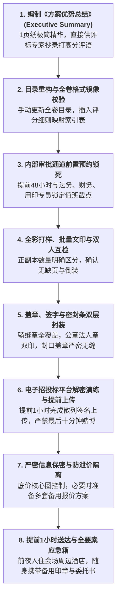

# 第51讲：标书封标、检查与提交：“最后一公里”防翻车 Checklist

> **【本讲一句话心法】**  
> 几个月乃至数年的技术攻坚与商务运作，最终全系于封箱、签字、盖章与送达这最后“临门一哆嗦”；在招投标的终点线前，墨菲定律的威力最为致命，唯有以零容错的铁血Checklist和极限冗余预案，才能确保战果安全入库。

---

## 一、 场景痛点与认知破局

在招投标漫长赛道的**“最后24小时”**，往往是所有售前团队肾上腺素飙升、最容易发生不可挽回悲剧的高危地带。许多耗资数百万、技术全面碾压对手的标杆项目，没有输在技术评估、没有输在商务报价，而是荒谬绝伦地**猝死在封标、送标与盖章的琐碎细节上**：

```
                ┌────────────────────────────────────────────────────────┐
                │          招投标“最后一公里”翻车惨烈实录 (Last-Mile Fails)   │
                └────────────────────────────────────────────────────────┘
                                           │
         ┌───────────────────┬─────────────┴─────┬───────────────────┐
         ▼                   ▼                   ▼                   ▼
   【封口漏章当场拒收】 【路上堵车迟到1分钟】 【审批卡壳印章锁死】 【电脑蓝屏前功尽弃】
   * 价值数千万的标书   * 9点开标9点01分送达  * 盖章人下班关机失联  * 截标前1小时系统死机
   * 封口缝隙漏盖骑缝章 * 门卫无情拒收退回   * 内部OA流程卡在财务  * 未做云端/物理多重备份
   * 标书原封不动被退回 * 几个月心血瞬间化为泡影* 拿不到实体章无法封箱* 电子标加密解密失败
   * 连拆封的机会都没有 * 团队在现场抱头痛哭 * 凌晨在街头急得团团转 * 彻底沦为全行业笑柄
```

### 1. 售前在收尾提交阶段的四大血泪教训
* **教训 1：封口密封瑕疵导致“连拆封机会都没有”**  
  招标文件明确要求“外包装密封处必须加盖投标人公章及法定代表人印鉴”。结果商务专员在慌乱中只盖了公章、漏盖了法人私章；或者封条只贴了一半、缝隙未被印章完全覆盖。评标委员会在开标第一环节核验密封性时，直接依据法定规则宣布“密封不合格，按废标处理”，连标书正本都未被允许拆封，整箱直接原封退回！
* **教训 2：侥幸心理作祟，迟到一分钟直接出局**  
  自恃距离开标会场只有10公里，未留足早高峰堵车与安检排队的冗余时间。结果遭遇早高峰车祸封路，9点整截标，代表在9点01分气喘吁吁冲入现场。公证处与招标代理当场冷酷拉响拒收警报，依法当场拒收。**在法定程序面前，迟到1秒钟与迟到1年没有任何区别！**
* **教训 3：内部审批流程前置不足，遭遇“印章死锁”**  
  很多大公司印章管理极其森严，必须走完风控、法务、财务和分管VP等层层审批。售前在截标前夜凌晨才写完标书，此时负责盖章的行政专员手机关机、领导在出差飞行途中无法登录OA系统，硬生生导致标书由于盖不上公章而无法封标。
* **教训 4：缺乏信息保密意识，核心底价在最后一夜泄露**  
  在投标冲刺期，很多人在公共微信群、公司大走廊高谈阔论最终报价；或者将底价早早录入没有行级权限隔离的旧CRM系统中，被内部被友商策反的“内鬼”一眼看光，导致友商在开标现场以精准低于我方0.1%的绝杀价逆风翻盘！

### 2. 认知破局：“最后一公里的零容错铁律”
* **“小心你的猪队友！”**：在招投标大决战的最后关头，团队的脆弱性取决于最弱的那块短板。不是每个人都像主战售前一样拼尽全力，任何一个行政环节的漫不经心都足以让全盘皆输！
* **“以最坏的可能倒逼应急冗余”**：  
  把所有不可控变量都预设为必然暴雷——假设堵车2小时、假设打印机卡纸、假设电脑蓝屏、假设系统崩溃！**用严密的双机热备、备用公章、异地前置住宿与纸质Checklist，彻底封死意外的一切缝隙！**

---

## 二、 核心方法论与原理拆解

### 1. 投标文件终局收网“八道防火墙”模型

从终稿冻结到开标唱标，必须严格筑起八道纵深防御工事：



---

## 三、 售前实操标准动作（SOP / 打法步骤）

### 步骤1：撰写致命杀手锏——《方案优势总结（Executive Summary）》
* **专家的终极痛点**：专家在打完分后，必须在评标报告中手写每一家厂商的“综合评审评语”，极度耗费精力；
* **售前的神来之笔**：在标书扉页之后、正文之前，插入一份**严格控制在1页纸（最多不超过2页）的《方案优势总结（Executive Summary）》**：
  * 精炼提炼：① 业务理解三优势；② 技术架构三亮点；③ 原厂交付三承诺；
  * 排版字号放大，用表格和精练要点呈现。**专家翻开标书第一眼看到它，不仅能瞬间看清方案全貌，更能直接把这段话复制粘贴进官方评标打分意见栏！**

### 步骤2：执行“总体目录重构与评分映射索引”
* 将各个子模块拼装为完整大文件后，**必须在 Word 中执行“右键 -> 更新域 -> 更新整个目录”！**
* 逐行检查目录，彻底消灭“错误！未定义书签”；
* 在目录前插入《招标文件技术与商务评分项索引表》（明确列出：细则第几条 -> 见标书第几章第几页），让专家翻书如翻字典般丝滑。

### 步骤3：盖章装订“双人盲审流水线”（Four-Eyes Principle）
* 打印完成后，设立“装订双人流水线”：
  * **一人盖章，一人核对**：一人负责翻页加盖公章与骑缝章，另一人拿着《盖章清单表》逐页在对照表上打勾；
  * **正本与副本严格隔离**：正本所有签字必须由法人代表或授权人亲笔手写签名（严禁使用签名章或复印件），所有业绩合同与审计报告原件必须装入正本；
  * **密封条粘贴标准**：用坚固封箱胶带密封后，再贴上白色加厚密封条，**公章必须一半盖在密封条上、一半盖在包装箱体上（骑缝无缝覆盖）！**

### 步骤4：送达现场与防突发应急部署
* **异地投标法则**：凡涉及跨城市投标，送标团队**必须在开标日前一天下午抵达目标城市，并直接入住距离开标交易中心 1 公里以内的星级酒店！**
* **全要素备用公文包必备**：
  * 授权代表身份证原件及复印件（至少3份）；
  * 法人授权委托书原件（加盖公章，备用3份）；
  * 公司空白介绍信（加盖公章备用）；
  * 红色印泥与黑色签字笔；
  * 存放电子标脱密版及述标PPT的加密U盘2个。

---

## 四、 实战工具箱、话术与Checklist

### 1. 标书正文最前页《方案核心优势总结（Executive Summary）》模版

```
========================================================================================
【方案核心优势总结】某集团核心业务数字化中台升级项目投标文件
投标人：【我司全称】                           响应标段：第一标段（核心系统软件与服务）
========================================================================================
尊敬的评标委员会各位专家：
针对贵司本次数字化中台升级项目的战略诉求，我司方案具备以下九大不可替代之核心优势：

【一、业务场景深度契合度（场景领先）】
 1. 业务零停机割接架构：针对贵司全天候业务特征，独创“双轨旁路灰度割接”，保障老系统向新平台
    平滑迁移，核心业务零感知中断。
 2. 本地化流程规则预置：已内置适配贵司所属行业的 120 种标准业务流与规则，交付周期压缩 40%。
 3. 国密安全与信创全面合规：已通过国家信息技术安全研究中心测评，满足等保四级与信创100%适配。

【二、技术底座性能与稳定性（架构领先）】
 1. 跨城三中心双活高可用：极端单数据中心断电下，系统在 2.1 秒内自动完成无损倒换（RPO=0）。
 2. 毫秒级海量高并发处理：经国家权威机构检测，单集群承载并发突破 50,000 TPS，时延<10ms。
 3. 动态背压流控机制：具备专利自适应流量削峰机制，杜绝月初月末结账时的报表告警风暴。

【三、专业交付与原厂确定性保障（服务领先）】
 1. 全明星原厂专家挂帅：拟派驻项目经理老李（15年金融IT老兵，主导过3个国家级标杆大中台建设）。
 2. 核心团队零轮换法律承诺：书面签署法定承诺函，项目初验前核心骨干人员零离职、零更换。
 3. 本地化 30 分钟极速响应：距离贵司仅 3 公里设立常驻技术支持中心，提供原厂 7×24 小时现场守护。
========================================================================================
```

### 2. 封标与交标前终极防翻车 Checklist

> [!TIP]
> 标书贴上封条前的“终极生死排查单（必须逐项打勾核验）”：
> - [ ] **正副本数量核对**：招标文件要求几正几副？（如：1正4副），现场装订数量是否严格吻合？
> - [ ] **正本每一处签字**：法定代表人或授权代表是否在“投标函”、“报价表”、“授权委托书”上亲笔手写签名？
> - [ ] **投标保证金凭据装订**：银行汇款回单或电子保函复印件是否已装订在正本指定位置？
> - [ ] **报价表大写金额无误**：大小写金额是否完全一致？（法律规定：大写与小写不一致时，以大写为准！）
> - [ ] **封签与密封章覆盖**：包装箱所有开口缝隙是否已全量覆盖密封条？公章是否跨越密封条与箱体加盖？
> - [ ] **电子招投标双重确认**：电子标书是否已在平台提前上传成功？CA数字证书（国密锁）是否已装入随身公文包随身携带？
> - [ ] **送标人身份证原件**：送标人及授权代表本人身份证原件是否已装在口袋（严禁误封装进标书箱内）！

---

## 五、 真实标杆案例深度复盘

### 【案例背景】某千亿省级能源集团数字化管控平台投标：开标现场的生死逆转

* **情景 (Situation)**：某省能源投资集团启动全集团智慧管控与财务共享平台招标，预算2400万元。入围决战的是综合集成巨头D公司与自研软件领军企业Y公司。
* **冲突 (Task)**：在开标现场，全省公共资源交易中心严肃的大厅内，四家投标人依次递交密封文件。当招标代理与公证员当众审查D公司的标书包装箱时，公证员拿起放大镜仔细审查D公司的封签，当场宣布：“**D公司投标正本文件箱，左下角封口处有一道长达5厘米的缝隙未被密封条完全覆盖，且该处缺少公章覆盖，不符合招标文件第二章第 18.2 条关于‘全密封无缝加盖公章’的实质性要求！依据法规，判定密封不合格，拒收并废标！**”
* **现场惨状 (The Disaster)**：
  1. D公司的投标代表当场脸色惨白、双腿发抖，当场向招标人求情解释这是文印店封箱时胶水粘度不够导致脱落；
  2. 但在法定的公开开标纪律下，公证处毫不留情，直接出具公证拒收函。D公司前期数十名售前与销售长达半年的心血，连展示技术的机会都没有，直接在门口夭折！
* **行动 (Action)**：
  * 反观Y公司，售前总监老魏在封标上展现了铁血纪律：
    1. 标书箱采用定制的双层防水加厚牛皮纸包裹，内层封口后加盖6枚公章；
    2. 外层再整体套上全封闭牛皮纸箱，四角与缝隙使用专用防撕毁易碎密封纸全量覆盖，并加盖了整整12枚清晰无瑕的公章与法人名章；
    3. 公证员审查Y公司的箱子时，挑不出任何瑕疵，全票评定为“密封完美规范”；
    4. 随后在技术评审中，Y公司扉页的《方案核心优势总结（Executive Summary）》获得了五位外部专家的高度赞誉，专家在写评审报告时几乎全盘引用了Y公司的总结词。
* **结果 (Result)**：Y公司不仅技术分斩获全场最高分，更以规范严谨的作风征服了评标全场，最终顺利拿下该2400万年度重大标杆工程！

---

## 六、 血泪教训与避坑红线

> [!WARNING]
> **红线 1：严禁把授权代表“本人身份证原件”误封装进密封标书箱中**  
> 这类荒唐事故在招投标江湖屡见不鲜！代表在封标现场手忙脚乱，顺手把装有自己身份证原件的钱包或文件夹塞进了正本标书箱内封死。到了开标现场，交易中心安检与公证员核验身份时必须出示身份证原件。代表无法自证身份，拆箱取身份证则当场违规废标，不拆箱则无法入场核验，直接陷入绝地死局！

> [!CAUTION]
> **红线 2：严禁尝试在截标前最后10分钟才提交电子招投标网络标书**  
> 网络电子招投标已成为主流。很多政企交易平台的服务器在截标前半小时会面临数十家供应商并发上传的巨大网络流量冲击，系统极易发生卡顿、CA数字证书握手超时、或者网络闪断。如果在最后10分钟才开始上传上百兆的加密标包，一旦进度条卡在99%，哪怕差1秒钟，系统就会在截标时刻强制自动关闭入口，直接判定未递交！**必须提前至少1小时完成上传！**

---

## 七、 课后思考题与实战研讨指南

### 思考题 1
为什么说在数百页厚重的投标文件最前页插入一份《方案核心优势总结（Executive Summary）》，能够对评标委员会外部专家的心理产生决定性的积极影响？请为你当前负责的方案，提炼一段不超过 500 字的精简 Executive Summary。

> **【实战研讨指引】**  
> * **心理击穿机制**：外部专家面临海量文字认知过载，注意力极度稀缺；一份结构工整的 Executive Summary 是为专家搭建的“认知捷径（Mental Shortcut）”；  
> * **实战提炼三部曲**：  
>   1. **业务痛点共鸣句**（直击客户面临的核心行业挑战）；  
>   2. **三大架构硬核指标**（量化高可用、并发、安全合规）；  
>   3. **交付无忧确定性承诺**（核心团队锁定、本地SLA响应）。

### 思考题 2
在投标全流程中，你认为团队中最容易出现致命纰漏的“猪队友环节”通常发生在哪些角色或哪些场景中？作为主导大局的售前项目经理，你应该建立怎样的“预防机制与备用冗余（Plan B）”，以确保任何单一环节出现人员脱节或失误时，投标战车依然能够准时无误冲过终点线？

> **【实战研讨指引】**  
> * **三大高危猪队友场景**：  
>   1. **印章管理人员失联**（节假日下班不接电话）；  
>   2. **送标交通堵车或走错会场**；  
>   3. **资质证书原件被其他项目借出外地未归还**；  
> * **四大铁血 Plan B 冗余**：  
>   * 提前48小时完成全部公章用印；  
>   * 准备包含法人授权委托书、介绍信备用件的“应急随身公文包”；  
>   * 送标人员前夜入驻会场旁酒店；  
>   * 资质证书全量彩色高清矢量扫描归档，并备好公证处公证件。
