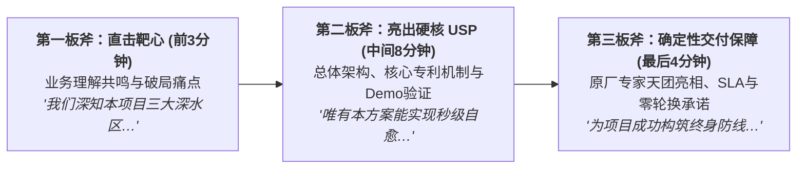
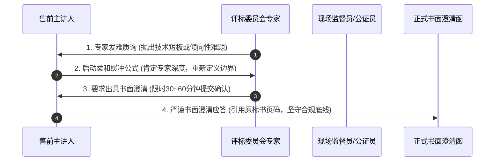

# 第52讲：决胜开标与评标现场：述标技巧、答辩攻防与合规暗礁

> **【本讲一句话心法】**  
> 标书递交不是战斗的终点，述标与答辩才是决定生死的白刃战；在短短15分钟的极限窗口内，以直击痛点的架构代差打穿专家心智，以柔和而坚定的专业风度化解暗桩刁难，在合规红线之上夺取最终胜利。

---

## 一、 场景痛点与认知破局

在招投标程序的决胜关头，许多采购项目（尤其是竞争性磋商、竞争性谈判或重大公开招标）设立了**“现场述标（讲标）与专家答辩（Q&A Defense）”**环节。很多售前工程师往往误以为“标书都写全了，述标不过是走个过场念一遍PPT”：

```
                ┌────────────────────────────────────────────────────────┐
                │          现场述标答辩的三大致命翻车 (Defense Fails)         │
                └────────────────────────────────────────────────────────┘
                                           │
         ┌───────────────────┬─────────────┴─────┬───────────────────┐
         ▼                   ▼                   ▼                   ▼
   【超时念稿被直接掐麦】 【答辩抬杠激怒专家】 【当场违规修改实质】 【遇到暗桩方寸大乱】
   * 15分钟限时讲了5页  * 被专家质疑后脸红脖子粗* 随口承诺“这个免费送”* 友商倾向专家尖锐发难
   * 通篇照读标书废话   * 当场和老教授据理力争* 触犯不得改变标书红线* 售前支支吾吾哑口无言
   * 被计时器响铃无情赶走* 专家打出全场最低技术分* 被其他供应商录音废标* 导致全场评委产生动摇
```

### 1. 现场述标答辩的四大致命短板
* **短板 1：缺乏时间概念，照本宣科被“强行掐麦”**  
  评标现场时间极其严苛，通常每个厂商只给10~15分钟述标、5~10分钟答辩。很多售前没有经过演练，前8分钟还在讲公司发展史和资质荣誉。刚讲到系统架构，主评委直接按响铃铛：“时间到，请停止陈述进入答辩！”最核心的USP和落地保障根本没来得及展示，痛失好局。
* **短板 2：答辩情商低下，当场与评审专家“神仙打架”**  
  当外部专家（通常是高校老教授或业内资深总工）对方案中的某个算法或协议提出质疑甚至存在认知偏差时，年轻气盛的售前在台上寸步不让，当面反驳“老师您理解错了，现在的微服务不是您那个年代的做法”。专家颜面扫地，直接在打分栏的“方案成熟度”上扣除大十分。
* **短板 3：缺乏合规敬畏，随口承诺触犯“实质性变更红线”**  
  在答辩过程中，面对专家关于“能否增加某边缘功能”的随口询问，售前为了抢表现，脱口而出“没问题，这个我们免费送，不收钱！”这种言论在法定招投标录音录像环境下是致命的违规行为——**依据法规，投标人在评标过程中严禁进行任何超出投标文件的实质性变更与让利承诺**，极易被在场的公证处直接记录为违规！
* **短板 4：遭遇友商暗桩恶意挑衅时阵脚大乱**  
  现场偶尔会遇到个别带有倾向性的评委，故意挑出极其偏门的刁钻问题企图把主讲人问倒。缺乏心理防线的售前当场手足无措、满头大汗，将不自信的负面情绪传导给全场中立专家。

### 2. 认知破局：述标答辩的“心流掌控与合规防御”
* **述标不是念标书，而是“高维划重点”**：专家手里已经有上千页标书，述标的唯一目的就是**在最短时间内，用最震撼的视觉和气场，告诉专家为什么只有我们能保住这个项目的成功，给专家打高分提供无可辩驳的心理依据**！
* **答辩是“职业成熟度与情商的大考”**：专家的提问往往不是为了考倒你，而是为了测试你在遭遇极端挑战时的沟通修养、工程严谨性与危机处置底线。

---

## 二、 核心方法论与原理拆解

### 1. 决胜述标“黄金15分钟”三板斧时间动力学模型

述标PPT必须严格遵循分秒必争的“三板斧”结构编排：



#### ① 前3分钟（直击靶心，拉平高度）
* 跳过冗长的公司简介（只用一句话带过：国家级专精特新、行业领军）；
* 直接亮出对客户最深层业务痛点的理解，展现懂业务的顾问格局。

#### ② 中间8分钟（硬核亮剑，展示技术代差）
* 重点展示总体架构拓扑图、核心算法调度机制、以及极端灾难自愈表现；
* 每一页胶片都明确标出对应的技术专利与权威机构测评数据。

#### ③ 最后4分钟（交付保底，高维收官）
* 具名亮出拟派驻的项目经理与架构师履历，宣读服务承诺；
* 留足最后1分钟从容致谢并宣布进入答辩，绝不超时拖堂！

---

## 三、 售前实操标准动作（SOP / 打法步骤）

在答辩攻防与现场书面澄清中，售前团队必须恪守以下四步标准战术动作：



### 步骤1：答辩应答万能四步公式（柔和而坚定）
当面对专家苛刻的挑刺与质疑时，主讲售前开口必须执行**四步应答公式**：
1. **第一步（情绪接纳与敬意）**：“感谢李专家极具深度与洞察力的提问，这个问题非常精准地切中了分布式系统在真实生产环境中的核心痛点……”；
2. **第二步（引用原标书页码）**：“正如我们在技术标书第 185 页《3.4 节网络分裂补偿机制》中所详细阐述的……”（向全场证明方案早有准备，绝非现场胡编）；
3. **第三步（客观数据与事实佐证）**：“我们通过独创的自适应心跳算法，在某国家级标杆客户处已稳定承载该场景运行超过三年，实测切换时延仅为 1.8 秒……”；
4. **第四步（谦逊请教收尾）**：“后续进场后，我们非常期待就这一算法的边界调优，进一步当面向各位专家深入请教汇报！”

### 步骤2：化解暗桩刁难的“太极卸力法”
* 遇到明显偏向友商的专家试图在某一细枝末节上把你逼入死角时，**坚决不与专家发生面对面的学术争论**；
* 采用“场景升华法”跳出泥潭：“专家提的这个参数在特定极限脱机环境下确实存在讨论空间。不过从本项目整体业务目标来看，系统的首要战略任务是保障业务连续性，我们在工程权衡上做到了综合最优。”

### 步骤3：现场书面澄清的“法务级起草标准”
* 若评委会要求对标书中某些表述出具书面澄清函，必须在30分钟内完成；
* **澄清铁律三原则**：
  1. **不超越原标书范围**：通篇必须建立在原投标文件的表述之上，严格引用原标书章节与页码；
  2. **不改变实质性内容**：绝不可在澄清函中改变投标报价、让利折让、或变更产品型号；
  3. **加盖公章与法人授权签字**：必须由随身公文包中的授权代表亲笔签字并加盖随身携带的合法公章。

---

## 四、 实战工具箱、话术与Checklist

### 1. 述标答辩现场经典攻防话术库

| 专家尖锐发难场景 | 错误应对（抬杠/心虚） | 顶级售前从容化解话术（专业+得体+合规） |
| :--- | :--- | :--- |
| **专家问：“你们这个架构虽然先进，但在我们省还没有同等规模的上线案例，稳定性如何保证？”** | “怎么没有？我们全国到处都是案例，省内没有是省内客户保守！”（当场得罪全场专家） | “专家看问题非常严谨务实！确实，本项目作为全省数字化转型的排头兵，对稳定性的要求高于一切。正因如此，我们带来了在相邻省份同等体量客户处连续四年无故障运行的原班架构团队，并把全部避坑经验沉淀到了本方案中。我们愿以‘原厂团队全职驻场+初验前核心骨干零更换’的法律承诺，为全省首个标杆的稳健落地提供100%的确定性！” |
| **专家质疑：“标书第80页写支持万级并发，我看你们的测试报告里只测到了8000，这是不是虚假应答？”** | 满头大汗支支吾吾：“额……这个可能写错了，研发当时跟我说能到一万的。”（自乱阵脚，涉嫌作弊） | “非常感谢张专家的敏锐核对！请允许我向各位专家说明：报告第82页体现的 8000 TPS，是在仅配置单台应用服务器的极限压测数据；而在标书第 85 页的总体部署方案中，我们为贵司规划的是四节点负载均衡高可用集群，整套集群的实测综合吞吐量达到 28,000 TPS 以上，留足了3倍以上的安全裕量，完全满足并优于万级并发之要求！” |

### 2. 述标与现场答辩 Checklist

> [!TIP]
> 踏入评标答辩室前15分钟自检：
> - [ ] **限时倒计时测试**：述标PPT是否已在12分钟内脱稿演练通过？（必须预留3分钟安全边际）
> - [ ] **激光翻页笔电池**：翻页笔电池是否为全新？激光指示点是否明亮？
> - [ ] **标书备用正本翻阅**：是否随身携带了一本标有彩色标签贴纸的纸质标书，以便在专家提问时在3秒内翻到对应页码？
> - [ ] **书面澄清授权链条**：空白加盖公章的澄清函纸张、印泥、黑色签字笔是否随身备妥？
> - [ ] **着装与气场锚定**：深色职业西装、领带/丝巾齐整、眼神自信平视全场评委。

---

## 五、 真实标杆案例深度复盘

### 【案例背景】某千亿省级医保核心平台述标答辩：逆风翻盘的5分钟绝杀

* **情景 (Situation)**：某省医疗保障局启动全省医保核心业务中台与反欺诈大数据稽核平台竞争性磋商，总预算1900万元。入围决战的是老牌央企系统集成商W公司与自研医疗大数据领军企业M公司。在上午的商务与资质打分中，W公司凭借庞大的企业规模略微领先M公司2分。
* **冲突 (Task)**：下午进入决定胜负的现场述标与答辩环节。W公司述标超时严重，主讲人在讲到一半时被主评委按铃打断；然而在随后的M公司答辩环节，一位偏向W公司的外部退休老专家突然发难，指着M公司的反欺诈算法模型发难：“小伙子，你们这个算法模型虽然发了论文，但在国内医保系统这种复杂非标数据流下，误报率极高，根本不可能在全省几千家药店落地！”全场气氛瞬间凝固。
* **行动 (Action)**：
  1. **从容步入白板，以退为进**：M公司主讲售前老徐微笑着向提问专家鞠躬致意：“老主任真是一眼切中要害，医保反欺诈最大的难点确实就在于非标异构数据引发的误报率！”；
  2. **白板推演，降维征服全场**：老徐拿起白板笔，行云流水地在白板上徒手画出“基于图计算与动态滑动时间窗的二级过滤状态机”；
  3. **用真实打击战果说话**：老徐指着白板说：“主任您看，我们在底层前置了业务规则白名单，在图计算层只针对高危聚集性套现进行拓扑穿透。这项机制上个月在国家医保局组织的华东区飞行检查打靶测试中，不仅实现了误报率低于 0.03%，更在现场成功拦截了 12 起虚假慢病购药团伙，追回医保基金 460 万元，这是国家局当时出具的表扬函（展示彩色扫描页）！”；
  4. **谦逊请教赢得人心**：解释完毕后，老徐诚恳表示：“老主任是当年起草全省首套医保系统的泰斗，在药店一线规则沉淀上有着极深造诣。项目中标后，我们恳请邀请主任作为我们的专家顾问委员会主任，指导我们把这套模型与全省的特色病种做进一步深度结合！”
* **结果 (Result)**：全场其他四位专家频频点头赞许，原本挑刺的老专家脸上露出了欣慰的笑容。最终打分出炉：M公司在技术述标与答辩单项上获得全场最高的 39.5 分（满分40分），净胜W公司整整5分，顺利实现总分逆风反超，斩获该省医保千亿级灯塔大单！

---

## 六、 血泪教训与避坑红线

> [!WARNING]
> **红线 1：严禁在答辩现场对评标专家进行人身指责或嘲讽**  
> 哪怕专家的提问明显带有偏见、甚至暴露出专家对现代技术的不了解，也绝不可在公开会场流露出“这你都不懂”的傲慢嘲讽！专家手中掌握着生杀予夺的打分权。在台上羞辱专家，等于亲手在自己的标书上判处死刑！

> [!CAUTION]
> **红线 2：严禁现场向评标专家打听其他竞争对手的报价或技术得分**  
> 评标过程受到严格的法律保密监督。任何试图向评标委员会打探消息、递纸条、甚至在走廊私下搭讪专家的行为，均会被现场纪检监察人员依法记录为“严重违规串标行为”，不仅当场取消投标资格，更会面临被列入招投标黑名单的法律制裁！

---

## 七、 课后思考题与实战研讨指南

### 思考题 1
为什么说“述标PPT绝不是技术标书正文的缩小版”，而是一部必须精心编排戏剧冲突与高潮的商业路演？请为你当前主讲的一个方案，设计一套能在开场前 180 秒内迅速抓住评委眼球的“破局大片式开场白”。

> **【实战研讨指引】**  
> * **商业逻辑**：标书是静态的审查文档，述标是动态的情绪与心流感染；述标必须在开场第1分钟建立痛点危机感，第2分钟抛出解法，第3分钟展现成效；  
> * **开场白示范**：  
>   “尊敬的各位评委专家大家下午好！用一句话概括今天我们向各位呈报的核心使命：**这不是一套普通的系统升级，而是一次帮贵局在未来三年规避数千万合规处罚、抵御极端业务洪峰的保命工程！** 在接下来的12分钟里，我们将用三项权威实测数据，向各位汇报我们是如何做到这三点的……”

### 思考题 2
在答辩现场，如果你遇到一位明显带有竞争对手倾向的评委，揪住你方案中一个无法回避的次要短板（如：单点接口适配暂不支持某一冷门古老协议）反复纠缠质问，试图在众人面前抹黑你的方案，你该如何运用“太极升维法”既体面礼貌地接招、又顺势将全场焦点转移到我方的压倒性核心优势上？

> **【实战研讨指引】**  
> 1. **大度承认客观事实，堵死纠缠空间**：“专家看问题极其敏锐！确实，该冷门协议属于上世纪的专用硬件接口，在现代云原生架构中已被国家标准全面替代”；  
> 2. **升华到全局架构合理性**：“如果在核心微服务中强行嵌入该老旧协议栈，会导致整个集群面临内存泄漏与网络阻塞的系统性风险；为了捍卫贵司核心生产业务的百年大计，我们在工程上采用了更先进的‘外挂式异步网关’进行无缝协议转换”；  
> 3. **顺势亮出压倒性 USP**：“正如我们在标书第 98 页所示，这种解法不仅100%兼容了该老旧设备，更将核心数据流的安全性提升了十倍以上！”
