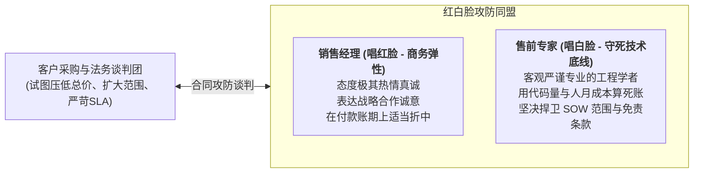
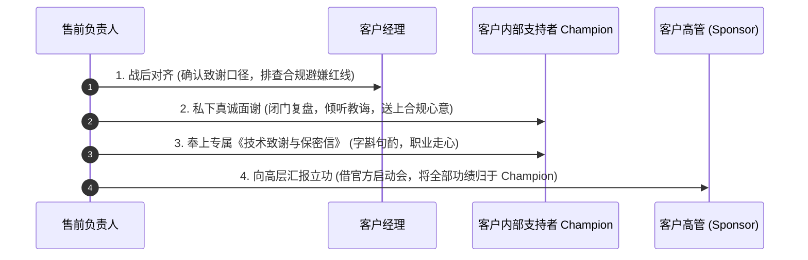

# 第53讲：商务谈判配合与致谢盟友的职场智慧

> **【本讲一句话心法】**  
> 中标不是终点，而是契约落地与人性考验的试金石；在商务谈判桌上与销售默契唱好红白脸死守技术底线，在胜选后以极高情商为幕后盟友奉上一封走心的感谢信，才是顶级售前行稳致远的无上职场智慧。

---

## 一、 场景痛点与认知破局

在中标候选人公示期结束、招标人正式下发《中标通知书》之后，项目随即步入**“合同最终谈判与签订阶段”**。面对即将落地的胜利果实，许多售前工程师往往会犯下两大缺乏商业与职场成熟度的致命错误：

```
                ┌────────────────────────────────────────────────────────┐
                │          中标后商务谈判与人际维系的典型偏航                 │
                └────────────────────────────────────────────────────────┘
                                           │
         ┌─────────────────────────────────┴─────────────────────────────────┐
         ▼                                                                   ▼
   【谈判桌上底线失守】                                                【胜利之后过河拆桥】
   * 误以为大局已定随便让步                                             * 一拿到中标通知书就彻底失联
   * 客户砍价时售前随口承诺“送模块”                                     * 对前期承担政治风险的 Champion 零感谢
   * 撕开 SOW 护城河给交付埋下雷区                                      * 盟友深感被当成工具人利用、心寒齿冷
   * 导致合同利润率遭遇腰斩式缩水                                       * 在后续交付验收与二期扩容中遭到致命反扑
```

### 1. 售前在合同签约阶段的两大短视行为
* **短视 1：谈判桌上充当“好好先生”，随意践踏交付边界**  
  在最终合同条款谈判时，面对客户采购部与法务的极限施压，有些售前缺乏博弈定力。为了促成合同快速签署，在客户提出“顺便把某两个子系统也接入进来吧”时，售前不假思索地拍胸脯：“没问题，既然都中标了，这个小功能我们顺手帮贵司做了！”这一轻率承诺直接把 SOW 中原本严密的 Out-of-Scope 防火墙彻底撕碎，导致中标后的商业毛利被瞬间吃光。
* **短视 2：“过河拆桥式”冷漠，寒了内部盟友的心**  
  在前期建立需求与技术评估阶段，客户内部的支持者（Champion / Sponsor / Coach）为你提供了海量内部真实动向、甚至冒着被友商举报的政治风险为你量身定制了评分标准。然而大局已定后，销售与售前只顾着在公司内部开庆功宴、发奖金，甚至连一条真诚感谢的微信都没有给盟友发过。盟友感到自己被当成了用完即弃的商业间谍，瞬间由铁杆盟友蜕变为冷眼旁观者，甚至在后续的初验付款环节故意卡扣签字！

### 2. 认知破局：合同谈判的“红白脸艺术”与“人脉资产复利”
* **合同谈判是“边界的最后加固”**：中标通知书确立的是合作资格，合同谈判界定的才是权利义务细节。售前必须与销售形成铁板一块的**“红白脸攻防同盟”**——销售在商业付款节奏上可以适度灵活（唱红脸），售前在工程工作量与SOW边界上必须坚如磐石（唱白脸）！
* **致谢盟友是“职业信誉与二期生意的定海神针”**：大客户采购绝不是一锤子买卖，后续长达3~5年的交付验收、追加变更、二期三期扩容，全系于与 Champion 的深度互信。**用最得体、最真诚、最合规的方式表达致谢，把商业合作升华为长期的职场盟友，这才是顶级售前最具复利价值的人性智慧！**

---

## 二、 核心方法论与原理拆解

### 1. 售前在商务谈判中的“红白脸协同”博弈模型

在面对客户采购与法务的严苛谈判时，销售与售前必须严格分工：



#### ① 销售唱红脸（情绪抚慰与商务斡旋）
* 销售主导商务与总价谈判：“张总、王主任，我们非常感谢贵司的信任，为了促成本次战略携手，我们在付款节点上可以全力配合贵司的财务要求……”

#### ② 售前唱白脸（守住技术与交付防线）
* 售前以客观中立的工程专家身份发言，给销售提供拒绝非分要求的台阶：
  * *话术范例*：“李总，王总刚才提到的这个新模块，如果只是表面画个界面很简单，但底层涉及到核心账户资金流的安全隔离。我们公司工程院有严密的防灾红线，若未配置独立的风控沙箱强行上线，会直接触发人民银行的合规审计风险。为了保障贵司本项目的百年大计，我们建议将这个模块严格列入二期规划，一期我们集中所有原厂精锐打透核心业务！”

---

## 三、 售前实操标准动作（SOP / 打法步骤）

### 致谢盟友的“职场高维感恩”四步法则

项目中标并正式签单后，售前必须在48小时内执行以下四步感恩动作：



### 步骤1：严守合规底线，坚决不搞违规重礼
* **铁律红线**：绝不可在中标后得意忘形地大张旗鼓送昂贵名牌、现金或贵重礼品！体制内客户极其敏感，这不仅会直接触犯国家廉政红线，更会将支持你的 Champion 推入纪检监察调查的万劫不复深渊；
* **高阶致谢载体**：一封亲笔撰写的走心信函、一套业内极为珍贵的前沿学术专著、或者一份结合其业务痛点的《未来三年行业前瞻洞察参考白皮书》。

### 步骤2：撰写一封高情商、走心的《致谢信》
* 致谢信绝不是空洞的客套，必须涵盖**三重境界**：
  1. **由衷敬意（Gratitude）**：感谢对方在方案打磨过程中展现的高超专业水准与远见格局；
  2. **共同成长（Growth）**：真诚表达“通过与您的多次深入探讨，我个人及团队对贵司业务的认知提升了一个台阶”；
  3. **终身保底（Commitment）**：郑重承诺自己绝不当甩手掌柜，后续将以原厂专家身份常态化督导交付，确保该项目成为 Champion 在体制内的无上标杆政绩！

### 步骤3：在客户高层面前“助其立功、名利双收”
* 在项目中标后的全集团启动大会或联合签约仪式上，售前与销售在面向客户高层领导致辞时，**必须将前期方案的先进性与合理性，全部归功于 Champion 及其团队的专业引领**：
  * *致辞范例*：“在长达三个月的技术评估中，正是李处长带领的项目技术骨干团队，以极其严谨负责的专业精神，对我们提出了多项直击业务要害的极高要求，才倒逼我们打磨出了这套兼具前瞻性与落地性的顶层方案。李处长团队对业务的深刻洞察令我们肃然起敬！”
* 让大领导当场对 Champion 赞赏有加，让 Champion 在单位内部赚足政治声誉！

---

## 四、 实战工具箱、话术与Checklist

### 1. 中标后致客户内部支持者（Champion）的高维致谢信范本

```
========================================================================================
                      【致谢与同行者备忘】向专业与远见致以最深敬意
致：【客户单位全称】 【Champion 职务与姓名】（如：科技部规划处 李处长）

尊敬的李处长：

见信如面。
随着本项目招投标与合同签订流程的圆满落地，我们悬着多日的心终于平稳靠岸。在欣喜之余，
我怀着无比真诚与敬畏的心情提笔给您写下这封信。

回顾过去这三个多月与您并肩推演方案的日日夜夜，对于我和我的售前团队而言，这绝不仅仅是
一次普通的商业竞标，而是一场极其宝贵的行业认知升华之旅。

在方案初期的数轮深入碰撞中，正是您敏锐指出的“双多活架构在极端老旧接口下的异步补偿盲区”，
一针见血地击中了我们实验室方案的软肋，倒逼我们调动了集团核心工程院资源进行专项攻坚，
最终打磨出了这套真正穿透贵司业务骨架的工程方案。坦率地讲，没有您长期深耕业务一线沉淀的
深邃洞察与严苛把关，就没有今天这套方案的成熟与厚重。

我们深知，您对这套方案的认可与支持，寄托着您对全省业务数字化转型的卓越抱负，也承载着
您对我们团队沉甸甸的信任与嘱托。

在此，我谨代表全体售前架构团队向您立下郑重承诺：
中标与签单只是长征的第一步。在接下来的项目实施与交付全生命周期中，我本人作为总架构师
绝不抽身离场！我将作为该项目的专家委员会主任，常态化督导现场交付进度与架构基线，
确保每一行代码、每一个接口都如期达到最优状态，决不辜负您的厚望！

风雨同行，幸甚有您。未来漫长的数字化征途上，我们愿继续充当您最得力的技术幕僚与马前卒，
与您共同见证本项目成为全行业的标杆丰碑！

再次向您的严谨、远见与胸怀致以最崇高的敬意！

                                            【我司全称】 资深售前总监 / 架构师：【老张】
                                            2026年XX月XX日
========================================================================================
```

### 2. 合同谈判与盟友维系 Checklist

> [!TIP]
> 中标公示后必须严格自检的“胜选行动单”：
> - [ ] **SOW 绝不妥协**：合同谈判中，任何客户新增的技术要求，是否均通过变更单（CR）机制合理抵挡或追加预算？
> - [ ] **唱好红白脸**：售前与销售在走进谈判室前，是否已对齐底线、明确谁负责拒绝不合理技术诉求？
> - [ ] **致谢信闭门递送**：是否已在签单后48小时内，通过合规私密途径向 Champion 表达了真挚感恩？
> - [ ] **高管汇报归功**：在项目启动大会的官方胶片中，是否已将方案亮点归功于客户团队的指导？
> - [ ] **二期线索埋雷**：在合同最终版本中，是否巧妙地在“系统扩展性”章节为明年的二期扩容预留了接口伏笔？

---

## 五、 真实标杆案例深度复盘

### 【案例背景】某万亿城商行核心账务重构：一封感谢信带来的三年战略同盟

* **情景 (Situation)**：某万亿城商行启动新一代分布式核心账务系统改造，合同标的高达4200万元。国内某自研金融科技厂商T公司经历长达半年的惨烈厮杀，最终力压两家老牌国际巨头成功中标。
* **冲突 (Task)**：在胜选之夜，T公司的销售团队在五星级酒店包厢大摆庆功宴，通宵庆祝。然而，售前总监老周却没有去喝酒。他一个人坐在办公室，回想起这半年里，银行科技部系统架构处老汪（我方核心 Champion）顶着行内多方保守派的巨大质疑，多次在深夜私下给老周指出架构盲区、指导方案修正。如今项目定了，老周知道老汪在行内正承受着巨大的选型责任压力。
* **行动 (Action)**：
  1. **次日清晨的真诚拜访**：第二天上午，老周没有带销售，独自一人敲响了老汪的办公室门。老周双手奉上一本在业内已绝版的《分布式事务系统设计原版讲义》，以及一封用钢笔手写、工整折叠的信件；
  2. **信中承诺“终身护航”**：老周在信中写道：“汪处，单子拿下来了，但我知道，您肩上的担子比以前更重了。行内很多眼睛在看着这个项目。今天我来不是向您表功，而是向您交底——项目交付期间，我每周五下午亲自到现场参加您的例会，直到初验上线！如果系统出了任何差错，我老周第一个到行长办公室领罚！”；
  3. **老汪的热泪盈眶**：老汪读完信，眼眶湿润。他紧紧握住老周的手说：“老周，商场上见过太多拿了单子就翻脸不认人的乙方。你这封信，让我觉得这半年的心血和担的风险，值了！”；
  4. **交付期的无私守护**：在随后的实施中，遇到行内个别业务部门挑刺刁难时，老汪多次在行长面前全力为T公司辩护；而老周也言出必行，带队攻关，系统最终在一年后以零差错惊艳上线。
* **结果 (Result)**：该项目不仅被人民银行评为全国金融科技创新卓越成果，老汪因此政绩顺利升任总行副行长兼CIO！在随后的三年里，该行所有的信创中台、风控大脑等后续二期、三期共计上亿元的重大项目，全部以单一来源采购方式直接委托给T公司建设！

---

## 六、 血泪教训与避坑红线

> [!WARNING]
> **红线 1：严禁在中标后四处炫耀“客户某某领导是我们的铁关系”**  
> 有些缺乏情商与职业纪律的售前或销售，项目一中标就在朋友圈或行业酒局上大吹大擂：“这次能赢多亏了科技部老李暗中帮忙！”这种愚蠢狂妄的言论一旦传回客户单位，会瞬间引发纪检调查与政敌攻击，直接置你的盟友于死地，更会将已经中标的项目毁于一旦！

> [!CAUTION]
> **红线 2：严禁在合同条款中擅自放弃“付款逾期利息与停服抗辩权”**  
> 很多客户的采购部在签约最后一刻，会强行要求删除合同中的“若甲方逾期付款，乙方有权暂停技术服务”的法定救济条款。售前与商务必须坚决协同守住底线！一旦放弃合法抗辩权，乙方在后续交付中面对客户的恶意拖欠将毫无还手之力！

---

## 七、 课后思考题与实战研讨指南

### 思考题 1
为什么说“在商业大单中标后，给客户内部支持者 Champion 写一封走心的感谢信，是性价比最高、护城河最深的商业动作”？如果你近期刚刚赢得了一个关键项目，请结合真实的合作历程，尝试为你身后的支持者撰写一段真挚而得体的致谢词。

> **【实战研讨指引】**  
> * **商业心理学机制**：体制内干部最缺乏的不是物质馈赠（物质往往伴随腐败风险），而是**“专业价值的深度被看见与政治声誉的绝对安全感”**；走心的感谢信恰恰满足了这一高层次心理诉求；  
> * **实战致谢词要素**：  
>   1. 肯定其在方案中的专业贡献（具体到某个架构细节）；  
>   2. 表达团队内心的敬佩与感恩；  
>   3. 郑重承诺交付全周期保底，誓死捍卫其政绩标杆地位。

### 思考题 2
在最终的商务合同谈判中，如果客户分管领导当面施压：“你们既然都中标了，这个小接口就顺便送给我们做掉吧，难道为了这点小事你们要放弃签约吗？”面对这种带有道德绑架与威逼性质的谈判施压，作为技术把关的售前，你该如何既给足领导面子、又滴水不漏地守住交付底线？

> **【实战研讨指引】**  
> 1. **大度接纳面子（赞赏领导的业务前瞻性）**：“王总，您站在全行业发展角度提的这个接口思路太超前了，极具业务穿透力！如果这个接口做通了，贵司在全省数字化版图上将再添一处核心亮点”；  
> 2. **摆出客观工程铁律（拉出第三方与合规做挡箭牌）**：“不过从软件工程的底层稳定性来看，这个接口直连了外部涉密专网，若在当前紧迫的一期工期内强行穿透，会导致整个核心集群在初验时无法通过公安部的等保四级渗透测试，进而影响贵司年底的整体上线考核”；  
> 3. **顺水推舟，固化为二期战略蓄水池**：“我们非常建议将这个创新接口作为本期工程的优先预留项，一期我们把标准架构和安全沙箱搭好，初验一通过，我们立即作为二期一号工程向贵司专题立项汇报，这样既稳妥又出彩，您看如何？”
