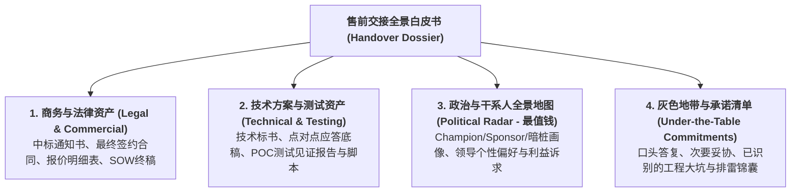
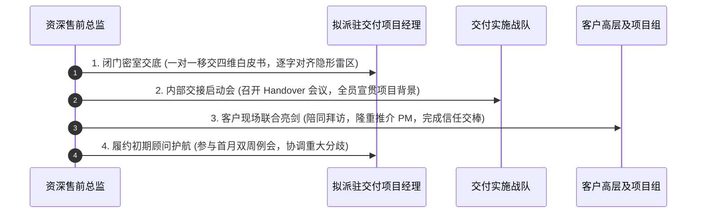

# 第54讲：项目交付交接（Handover）：从售前到项目经理的无缝交棒

> **【本讲一句话心法】**  
> 售前最恶劣的职业污点是“吹完牛拍拍屁股走人，留下交付接盘侠抱头痛哭”；完成一份包含合同底牌、技术边界与政治人脉地图的严密交接白皮书，扶上马送一程，才是专业售前善始善终的最高职业操守。

---

## 一、 场景痛点与认知破局

在绝大多数企业级软件与系统集成公司中，**“售前与交付（实施/工程）部门之间的矛盾”**几乎是一出永无休止的内部撕裂悲剧：

```
                ┌────────────────────────────────────────────────────────┐
                │          售前与交付“断崖式割裂”的恶性循环                 │
                └────────────────────────────────────────────────────────┘
                                           │
         ┌───────────────────┬─────────────┴─────┬───────────────────┐
         ▼                   ▼                   ▼                   ▼
   【售前签单庆功领赏】 【交付进场两眼一抹黑】 【踩中暗雷引发冲突】 【项目烂尾互相推诿】
   * 合同签完转身就跑   * 没看过标书/没看SOW  * 不知哪位领导是暗桩   * 客户指责承诺不兑现
   * 口头承诺全无记录   * 以为是标准开箱即用  * 当面得罪核心Champion * 交付痛骂售前乱吹牛
   * 政治背景完全保密   * 现场被客户当头棒喝  * 接口对接寸步难行     * 售前埋怨交付水平差
```

### 1. 缺乏交付交接（Handover）的三大系统性灾难
* **灾难 1：隐性口头承诺缺失，交付进场惨遭“当头棒喝”**  
  在前期长达数月的交流与投标中，售前与销售为了打动客户，曾私下答应过某些特定的技术补偿或界面微调（虽未写入SOW正文，但客户铭记在心）。若无正式交接，新进场的项目经理（PM）对此一无所知，按照僵硬的通用手册跟客户生搬硬套。客户第一天就勃然大怒：“当初你们老张怎么答应我们的？你们内部到底通不通气？！”商业信任瞬间崩塌。
* **灾难 2：政治与干系人地图缺失，交付无意中“得罪盟友、踩踏地雷”**  
  每个客户内部都存在复杂的派系斗争与利益博弈。新来的项目经理不知道李处长是支持我方的核心 Champion，不知道赵科长暗挺竞争对手。在第一次项目周会上，PM无意中纠正了李处长的一句话、或者采纳了赵科长的恶意拖延建议，硬生生把前期辛辛苦苦建立的统一战线彻底瓦解。
* **灾难 3：内部互相甩锅，公司陷入恶性内耗泥潭**  
  项目出现交付阻滞，交付总监在管理层例会上痛骂“售前为了拿提成不择手段乱许愿，把草台班子吹成神仙系统”；售前则在销售端抱怨“交付团队没有大局观、技术水平太水、把好端端的大客户做死了”。

### 2. 认知破局：Handover（项目交接）的契约与传承本质
* **“项目交付交接（Handover）是不可或缺的刚性法定工序”**：项目中标不仅是销售周期的终点，更是交付周期的起点。售前必须像传递接力棒一样，**不仅移交冰冷的合同文档，更要全盘移交前期的技术资产、商务底牌与人际信任**！
* **售前的“扶上马、送一程”责任制**：  
  在项目正式进场并顺利召开开工会（Kick-off）之前，售前绝不能彻底抽身离场！售前必须陪同项目经理完成首次高层会晤，当面将信任纽带平稳嫁接到项目经理身上，直到项目进入平稳正轨！

---

## 二、 核心方法论与原理拆解

### 1. 售前交付交接“四维全息白皮书”资产模型

一份合格、专业、让交付团队感动的项目交接，必须覆盖四大维度的全息资产转移：



#### ① 第一维：商务与法律底牌（明确权责与底线）
* 移交最终盖章的合同正本、工作说明书（SOW）、以及任何具有法律效力的补充协议（MOU）；
* 明确告知项目经理：**哪些条款在谈判中做过妥协，哪些款项节点存在客户内部付款审批的特殊卡点**。

#### ② 第二维：技术方案与工程底稿（减少重复劳动）
* 移交所有高精Visio架构图源文件、原型演示Demo源码、POC测试环境配置脚本；
* 详细说明点对点应答中哪些写了“带解释的完全满足”，指导交付团队按此标准进行模块验收。

#### ③ 第三维：政治与干系人地图（最值钱的隐形财富！）
* 详尽列出客户方核心干系人图谱：
  * **谁是我们的 Champion（李处）**：其核心诉求是政绩上线，平时说话要给足面子，遇到争议找他私下协调；
  * **谁是友商的同盟（王科）**：在系统验收时喜欢在接口性能上挑刺，必须提前准备好第三方压测报告应对；
  * **谁是高层一把手（张总）**：工作节奏雷厉风行，汇报时必须结论先行，极度看重汇报仪表。

#### ④ 第四维：口头承诺与排雷清单（杜绝踩坑）
* 白纸黑字列出《售前阶段非标准口头沟通备忘》：向客户口头解释过的概念、答应赠送的小工具、前期调研发现但标书未体现的客户历史老旧系统硬伤。

---

## 三、 售前实操标准动作（SOP / 打法步骤）

规范的交付交接必须严格经历以下四步标准化运作流程：



### 步骤1：闭门密室交底（一对一坦诚交心）
* 在召开团队大会前，售前总监与项目经理进行一次不少于2小时的闭门长谈；
* **坦白从宽、绝不隐瞒**：售前主动把项目前期所有的博弈内幕、客户领导的真实脾气、方案中哪几个模块存在工程风险毫无保留地交代清楚；
* 项目经理心中有底，绝不会在现场陷入被动。

### 步骤2：召开正式《内部项目交付交接誓师大会》
* 由PMO组织，销售、售前、交付全员出席；
* 售前进行全景方案串讲，移交全套电子及纸质文档资产包；
* **三方正式签字确认**：售前、销售与项目经理在《项目交付交接备忘录（Handover Sign-off）》上联合签字盖章，正式完成法律与组织层面的权责转移。

### 步骤3：客户现场“隆重交棒仪式”（Kick-off 亮剑）
* 项目进场第一天，**售前总监必须亲自陪同项目经理前往客户现场！**
* 在由客户分管领导出席的项目开工启动会（Kick-off Meeting）上，售前负责前半段“方案背景回顾”，并隆重推介项目经理：
  * *话术范例*：“张总、李处，今天我非常自豪地向各位领导引见我们公司最资深的交付王牌老李。老李操盘过三个同体量的国家级大工程。从今天起，老李将全面接管现场战队，而我将作为本项目的专家委员会主任持续在后方督导，我们全力以赴确保项目圆满成功！”
* 一举打消客户对“换人后水平不行”的疑虑，让项目经理瞬间建立极高威信！

### 步骤4：前30天“护航期与例会机制”
* 项目进场的前一个月，售前必须保持每周至少一次与项目经理复盘沟通；
* 参加项目首次双周里程碑例会，协助项目经理化解初期的需求澄清分歧，直到交付团队与客户磨合顺畅。

---

## 四、 实战工具箱、话术与Checklist

### 1. 《售前项目交付交接清单与备忘录（Handover Checklist）》模板

```
========================================================================================================
【项目交付内部交接备忘录】某集团智慧数字中台项目 Handover 归档卷
交接时间：2026年11月05日              交接地点：公司总部第二会议室
移交方：资深售前老张（售前总监）     接收方：交付项目经理老李（资深PMP）   见证方：销售大陈、PMO总监
========================================================================================================
 一、法定商业与合同资产移交清单（全部加盖公章与合同原件）
  [√] 中标通知书原件及招标代理盖章开标记录表
  [√] 正式商务合同正本（含《附件一：SOW 工作说明书》、《附件二：技术规范偏离表》）
  [√] 最终版分项投标报价明细表与财务内部成本预算核算单
  [√] 客户招标需求书（RFP）与三轮官方答疑澄清纪要文件

 二、核心技术与工程设计资产
  [√] 投标文件技术方案终稿（Word及矢量Visio架构图拓扑源文件）
  [√] POC 概念验证测试报告（含客户总架构师亲笔签字确认单与全真压测脚本）
  [√] 核心系统产品线标准安装包与 License 申请审批通道说明
  [√] 与第三方老旧系统对接的标准 OpenAPI 规范草案

 三、干系人政治雷达与人脉地图（内部机密资产）
  干系人姓名   部门职务      政治阵营倾向   核心诉求与考核关注点                   沟通避坑准则
  ------------------------------------------------------------------------------------------------------
  李处长       科技部规划处  我方核心Champion  看重项目年底能否按期作为集团数字化政绩   极其严谨，多在私下汇报请教
  王科长       数据管理科    偏向老牌友商      担心新系统影响现有旧数据库稳定与运维压力 遇到提问多摆出第三方压测数据
  张副总       分管IT副总裁  最终经济决策人    看重宏观ROI、业务不中断与监管合规       汇报直奔主题，切忌讲技术黑话

 四、非标准口头约定与灰色边界提示（重点风险预警）
  1. 口头承诺项：售前在技术答辩时曾私下承诺，在初验前协助数据科开发 2 个轻量报表原型（未列入SOW，
     建议交付团队在现场以“技术赋能支持”名义友好提供，借此搞好与王科长关系）。
  2. 历史系统暗坑：客户现有旧 ERP 系统的数据库存在部分字符集乱码历史遗留问题，迁移前必须提醒客户
     先执行源端清洗，切忌由我方脚本直接强行覆盖！

 =======================================================================================================
 移交人签字（售前）：___________    接收人签字（项目经理）：___________    销售确认：___________
========================================================================================================
```

### 2. Handover 交付交接闭环巡检 Checklist

> [!TIP]
> 售前在抽身离开项目前，必须逐项确认的“交棒自检表”：
> - [ ] **四维白皮书文档归档**：是否已在公司内部知识库或协同平台上建立唯一项目目录并完整上传？
> - [ ] **三方签字备忘签署**：售前、项目经理、销售是否已在《交接备忘录》上亲笔签字留档？
> - [ ] **客户高管现场推介**：是否已陪同项目经理完成首次客户现场拜访，并向客户一把手隆重交棒？
> - [ ] **微信协同群权限转移**：是否已在项目实施群中将项目经理设为主理人，并公开宣布由其统筹现场事务？
> - [ ] **后方顾问角色保留**：是否已向项目经理明确承诺“遇到重大商务变更与技术争议随叫随到”？

---

## 五、 真实标杆案例深度复盘

### 【案例背景】某千亿制造巨头全球MES系统交付：一场教科书级的交棒大逆袭

* **情景 (Situation)**：国内某千亿级高端制造集团启动全球超级工厂新一代MES制造执行系统改造，合同金额2100万元。国内某工业互联网龙头厂商C公司成功中标。
* **冲突 (Task)**：该项目现场极其复杂：涉及到全厂5000余台不同年代的德国、日本数控机床与老旧PLC的底层协议采集。以往这类项目最容易出现“售前签完单拔腿就跑，项目经理进场被客户骂得狗血淋头”的恶性循环。
* **行动 (Action)**：
  1. **老售前老孙的四维交接长谈**：售前总监老孙在签约后的第一个周末，将拟派驻的项目经理小周约到公司作战室，闭门长谈整整一天；
  2. **移交“排雷锦囊与干系人图谱”**：
     * 老孙把在长达四个月调研中手绘的《全厂老机床协议暗坑分布图》毫无保留交给小周；
     * 重点点明：生产调度处老刘是厂里的老劳模，对任何新系统都极其排斥，但老刘极度看重尊重。老孙嘱咐小周：“进场第一天千万别讲工业4.0，带上安全帽直接去车间给老刘递支烟，请教他机床老毛病，老刘就会从最大阻力变成头号帮手！”；
  3. **现场开工会的隆重托举**：
     * 在全厂动员开工大会上，老孙不仅陪同小周坐在前排，更当着集团制造副总裁和全厂车间主任的面，深情致辞推介小周：“周总是我们公司工业物联网领域的首屈一指的实战专家，曾在常州打造过国家级灯塔工厂。未来一年，小周将代表公司常驻车间。小周的任何技术决定，就是我们工程院的决定！”；
     * 这一番话让小周在全厂干部面前瞬间树立起崇高的专业威信；
  4. **首月并肩作战，平稳交棒**：小周进场后第一周严格遵照老孙的锦囊，成功将老刘拉拢为同盟；在遇到第一次复杂接口联调争议时，老孙专程飞抵现场，协同小周有理有据地化解了外方机床厂的推诿。
* **结果 (Result)**：该项目在一年后以零延误、零超支的完美状态顺利通过全厂大终验，被工信部评为全国智能制造示范标杆！项目经理小周不仅没有抱怨售前，更在公司年度大会上公开感谢老孙：“没有孙总教科书级的Handover，这个项目在第一个月就死掉了三次！”两位技术骨干结成了生死与共的黄金搭档。

---

## 六、 血泪教训与避坑红线

> [!WARNING]
> **红线 1：严禁以“邮件抄送一下文档就算交接完成”的官僚作风糊弄事**  
> 有些售前为了图省事，把几十个附件往邮件里一堆，抄送给项目经理，附上一句“资料都在附件里，祝交付顺利”，便自以为完成交接。这种冷漠的甩包袱行为不仅无法传递隐性经验，更会导致项目经理在遭遇挫折时直接将邮件作为证据告到管理层，引发严重的组织内耗！

> [!CAUTION]
> **红线 2：严禁交接后在客户面前与项目经理“公开唱反调、拆台脚”**  
> 项目进场后，客户有时会私下给售前打电话打小报告：“你们这个新项目经理太死板了，不如你变通。”此时售前必须坚决维护项目经理的威信与防线！绝不可自以为是地在电话里背着项目经理许愿或者批评项目经理。公开拆自己兄弟的台，只会让客户利用内部矛盾大肆勒索！

---

## 七、 课后思考题与实战研讨指南

### 思考题 1
为什么在企业级项目的交接中，“干系人政治雷达与人脉地图”往往被公认为比纯技术架构图“更为昂贵和关键”的资产？如果交接给项目经理的干系人信息失真或缺位，通常会在现场引发哪些难以挽回的交付风暴？

> **【实战研讨指引】**  
> * **本质剖析**：代码和架构是理性的，而推进项目的是活生生的人；技术问题可以加班攻克，但一旦得罪了关键决策者或站错了派系，项目会被无休止的官僚流程直接掐死；  
> * **失真恶果**：误把对手当盟友泄露交付难点、误触领导禁忌引发高层震怒、忽视基层痛点引发全员抵制上线。

### 思考题 2
请为你近期成功签约的一个项目，草拟一份能直接移交给现场项目经理的《项目非标口头约定与潜在地雷排查卡》。你将如何既真实披露前期的妥协与短板、又给予项目经理充沛的信心和应对策略？

> **【实战研讨指引】**  
> 1. **列出所有“虽未写入合同但客户极为在意”的边缘细节**；  
> 2. **剖析地雷成因与安全引爆机制**（如：老接口可能存在时延抖动，建议交付进场后优先设计本地缓存兜底）；  
> 3. **提供后方支持承诺**（明确写出：该模块原厂首席研发阿强的专线电话，遇极端Bug阿强承诺2小时内远程介入支持）；  
> 4. 让项目经理感受到他背后站着强大的技术军团，而不是孤立无援的炮灰。
