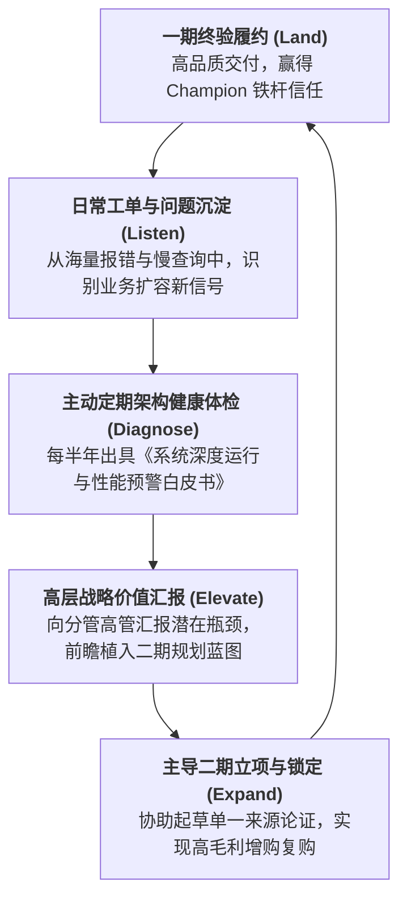
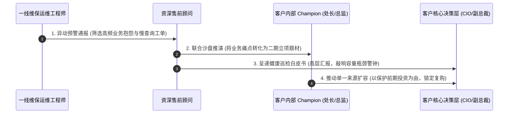

# 第55讲：维保与服务运营：在客户日常问题中挖掘二期三期增购商机

> **【本讲一句话心法】**  
> 维保从来不是吃力不讨好的“成本负担与售后擦屁股”，而是深耕存量客户的最强“商机蓄水池”；在客户日常业务的每一次抱怨、卡顿与工单中，听见业务演进的深层脉搏，主动策划二期三期，才能将一次性合同做成基业长青的参天大树。

---

## 一、 场景痛点与认知破局

在企业级 IT 市场中，开发一个全新客户的获客成本（CAC），通常是维护并深耕一个老客户的 **5倍到8倍以上**！然而，在绝大多数企业中，一旦项目通过终验、进入为期数年的**“维保与服务运营阶段（Maintenance & Operations）”**，售前与销售团队却往往表现出惊人的**“集体失明与阵地失守”**：

```
                ┌────────────────────────────────────────────────────────┐
                │          维保阶段“阵地失守”的典型商业悲剧 (The Churn)       │
                └────────────────────────────────────────────────────────┘
                                           │
         ┌───────────────────┬─────────────┴─────┬───────────────────┐
         ▼                   ▼                   ▼                   ▼
   【视维保为成本擦屁股】 【甩给外包不管不问】 【日常抱怨越积越多】 【二期发标被友商端走】
   * 终验拿完全款立刻撤场* 现场只有初级运维  * 客户感到被冷落轻视 * 客户默默规划千万二期
   * 售前销售彻底失联   * 只会机械修Bug打补丁* 业务新诉求无人响应 * 重新公开招标换掉我方
   * 放弃日常客户经营   * 缺乏高层对话通道   * 信任纽带逐年衰减   * 辛苦打下江山拱手送人
```

### 1. 传统企业在维保运营中的三大致命盲区
* **盲区 1：把维保视作“纯成本中心”，服务态度被动消极**  
  认为合同已经履行完毕，剩下的免费质保或微薄的维保费纯属公司倒贴人力。运维团队抱着“多一事不如少一事”的消极心态，客户提一个需求推脱三次，修一个Bug拖延数天，硬生生把一期建立的高端品牌口碑消耗殆尽。
* **盲区 2：缺乏商业嗅觉，把“业务演进诉求”粗暴当成“系统缺陷Bug”**  
  一线运维工程师技术敏感度不足，当业务部门反映“月末报表导出变慢了”、“希望增加某多维度分析看板”时，运维人员本能地回复“系统设计就是这样的，没有这个功能，合同没包含”，直接把客户萌发的新业务痛点生硬顶了回去。
* **盲区 3：战略失联，导致“一期种树，友商乘凉”**  
  售前与销售在项目终验后长达两年不登门拜访。殊不知在此期间，客户业务规模翻了三倍、分管高层换了届。当客户痛下决心投资2000万上二期时，由于我方长期缺位，敏锐的竞争对手早已趁虚而入，主导了二期的技术规划，最终以“推倒一期老系统”为卖点把我们扫地出门！

### 2. 认知破局：从“被动修Bug”升维为“顾问式持续耕耘”
* **“客户日常问题是价值连城的金矿”**：世界上没有任何一家企业的业务是静止不变的。系统上线只是数字化的第一步，随着业务的爆发，原有的架构必然面临新的并发瓶颈、组织流程再造与合规升级。**每一次用户的业务报障与体验抱怨，背后都是二期、三期系统扩容的天然催化剂！**
* **售前的“全生命周期顾问定位”**：  
  项目终验不等于售前使命终结！优秀售前必须将该客户列入“终身运营白名单”，定期回访、主动体检、前瞻立项，**协助客户将日常痛点打包升华为战略级新项目，争取通过“单一来源采购或原有合同合规扩容”牢牢锁死二期订单！**

---

## 二、 核心方法论与原理拆解

### 1. 存量客户价值飞轮与增购催化模型（Land & Expand）

在企业级客户运营中，优秀的方案商必须构筑“以维保为锚、以增购为果”的持续扩张飞轮：



#### ① 区分日常问题的“两种属性”
* **属性 A（故障型缺陷 - Defect）**：程序代码本身的低级错误或配置偶发异常。必须遵循SLA以最快速度抢修、安抚用户，守住服务底线；
* **属性 B（演进型瓶颈 - Evolution Signal）**：由于客户业务量增长（如用户量从10万激增至100万）、组织架构合并、或国家出台最新监管合规政策而引发的“能力不足”。**这是绝对的商业增购信号！售前必须迅速介入，将其包装为独立立项的新课题！**

#### ② 杀手级武器：《系统运行深度体检报告（Health Check Report）》
* 绝不等待客户投诉！每半年主动由资深售前带队进场，对系统数据库、缓存中间件、网络I/O及核心业务指标进行为期两天的深度巡检；
* 形成一份图文并茂、具有极高专业高度的《系统容量与业务健康评估报告》，向客户科技与业务高层汇报：
  * *汇报范式*：“张总，当前系统运行良好。但数据显示，贵司核心数据量近半年增长了180%，预计在今年双十一峰值时，底层存储I/O将达到92%的临界饱和红线。为保障核心生产业务连续性，我们建议在三季度提前启动二期分布式算力扩容规划……”

---

## 三、 售前实操标准动作（SOP / 打法步骤）

在维保期挖掘二期、三期商机，售前团队必须恪守以下四步标准作业流：



### 步骤1：建立与一线运维的“每月商机雷达会”
* 售前总监每月与本项目的运维负责人召开半小时对齐会，过滤当月工单：
  * 哪些业务部门提的需求最多？
  * 哪些报表运算时间超过了5分钟？
  * 客户领导最近在全员大会上强调了哪些新的业务战略方向？

### 步骤2：撰写并呈递《系统健康度与容量趋势分析报告》
* 将枯燥的系统日志转化为高管看懂的业务风险雷达；
* 重点揭示：**“随着业务发展，现有系统在未来6~12个月内必将遭遇的三大硬性瓶颈”**；
* 顺理成章附带给出《新一代二期功能演进与架构扩容路线图建议（Roadmap）》。

### 步骤3：协助 Champion 编写《二期项目立项请示与预算申报书》
* 协助内部盟友把二期项目的价值拉满，算清政治账与经济账；
* 为 Champion 准备立项答辩胶片，指导其向集团争取财政预算或科技专项资金。

### 步骤4：深度主导“单一来源采购或合同变更论证”
* **防守最高境界——避开公开招标**：
  * 协同客户采购部门深入论证《政府采购法》第三十一条或国企内部管理办法关于“必须保证原有采购项目一致性或者服务配套的要求，需要继续从原供应商处添购”的法定豁免条款；
  * 出具专业的《系统技术一致性与资产保护论证白皮书》，证明由原厂进行二期扩容能节省60%以上的集成成本并规避系统割接瘫痪风险；
  * 顺理成章促成单一来源采购或合同直接增补，彻底封死竞争对手的觊觎！

---

## 四、 实战工具箱、话术与Checklist

### 1. 从日常运维问题向二期商机升华转换话术库

| 客户日常报障与抱怨 | 传统运维消极回答（掐死商机） | 顾问式售前高维升华（催化二期立项） |
| :--- | :--- | :--- |
| **客户反映：“最近每到月末结账，导出各省销售报表要转圈卡死半小时，太慢了！”** | “合同里约定的就是单机导出，现在数据量比以前翻了三倍，服务器撑不住很正常，我们也没办法。” | “李主任，您反馈的这个现象非常敏锐且关键！这恰恰证明了贵司过去一年全渠道业务的高速爆发，原设计的一期单节点架构正在满负荷运转。为了彻底解决月末结账的后顾之忧，我们设计了一套‘分布式内存预聚合计算引擎’方案，不仅能将报表导出压缩至3秒内，更能直接支撑全集团高管手机端实时动态看盘。我们下周为您汇报一份二期算力加速专项方案，争取在年中立项推上去！” |
| **客户业务部门抱怨：“新出了一个退换货流程，现有系统配置太死板，改不了。”** | “我们这是标准产品，不支持你们这种非标流程。要改必须提需求走定制，费用很贵的。” | “王科长，这体现了贵司业务向精细化运营转型的敏锐调整。一期系统重在把基础进销存管牢，而面向多变的新业务，业界标杆做法是引入‘低代码可视化规则引擎’。有了这个引擎，未来业务科室自己就能拖拽修改流程，无需再找IT开发。我们把这个模块作为二期业务敏捷创新的核心亮点为您做好规划，协助您向科技部领导专场立项！” |

### 2. 存量客户二期增购孵化 Checklist

> [!TIP]
> 维保期每半年必须开展的“老客户深耕体检单”：
> - [ ] **高管人脉持续在线**：项目终验后，我司销售与售前是否依然保持每季度至少拜访一次客户核心高管（CIO/副总）？
> - [ ] **健康报告常态化递呈**：过去6个月内，是否向客户正式呈递过盖有公章的《系统运行健康与容量趋势报告》？
> - [ ] **新痛点与政策对齐**：客户所在行业近半年是否出台了国家或地方性的新监管法规（如数据要素、信创安全、新财会制度）？我们是否已将新规转化为二期升级提案？
> - [ ] **单一来源合规准备**：二期方案的规划是否紧密依托一期底座，是否已提前储备了《系统一致性与单一来源采购论证素材》？

---

## 五、 真实标杆案例深度复盘

### 【案例背景】某千亿省级农商银行数字化风控大脑：从百万一期到四千万全家桶

* **情景 (Situation)**：某省农信联社启动移动信贷风控引擎一期建设，中标金额仅为280万元，属于典型的“试水型小单”。国内某自研金融风控厂商F公司历经艰苦交付，在年底顺利通过初验。
* **冲突 (Task)**：系统上线半年后，全省农村普惠小额贷款业务爆发式增长，日均进件量增长了10倍。一线信贷审批员经常在微信群里抱怨：“系统规则太死，很多偏远乡镇种植户没有纳税数据，风控直接一刀切拒贷，导致基层网点完不成放贷指标！”
* **行动 (Action)**：
  1. **售前从工单抱怨中嗅出超级战机**：F公司的售前总监老常没有让运维人员简单应付了事，而是带领2名资深算法顾问进驻现场，调取了近半年的十万条审批日志；
  2. **编制震撼高层的《普惠金融风控盲区与增信升级白皮书》**：
     * 老常向总行主管信贷的副行长与科技部总经理呈递专项报告，指出核心症结：**现有系统缺乏多源涉农异构数据（如电网用电量、农业保险、土地流转卫星数据）的交叉融合与动态画像能力，导致每年有近20亿元的优质涉农贷款被误拦截！**
  3. **主动为客户顶层规划“二期全省智慧普惠大脑”**：
     * 老常团队在两周内免费为银行起草了全套二期建设规划方案，提出引入“多模态涉农知识图谱+联邦学习风控引擎”；
     * 测算商业账本：二期上线后，预计将为全省农商行系统释放每年超过50亿元的普惠信贷投放规模，年化直接增加利息收入过亿元；
  4. **锁定单一来源采购**：老常协助科技部出具严密的系统架构连续性论证，证明基于F公司一期引擎进行热升级，无需迁移核心数据，能够节省数千万元的重复建设成本并规避全省系统停服风险。
* **结果 (Result)**：总行党委会全票通过该二期重大立项，并经省财政厅与招标办严格论证，全额批准采用单一来源采购方式委托F公司建设！**二期合同金额高达3850万元**（是一期金额的近14倍）！F公司通过对维保期日常问题的敏锐捕捉与顾问式深耕，成功从一家边缘初创供应商，一跃成为该万亿农信系统的绝对核心战略伙伴！

---

## 六、 血泪教训与避坑红线

> [!WARNING]
> **红线 1：严禁以“二期有大单”为借口在一期交付中无原则倒贴与失控妥协**  
> 很多缺乏经验的售前在面对客户的无理索求时，总自我安慰：“现在先咬牙免费帮客户把这个复杂功能做了吧，反正客户口头答应了二期几千万全给我们”。商业世界充满变数！在二期合同没有真正白纸黑字盖章之前，一切口头承诺都是泡影。在一期中无底线妥协，只会让客户形成你“极其廉价、软弱可欺”的刻板印象，甚至在一期把交付团队彻底拖死！

> [!CAUTION]
> **红线 2：严禁对老系统的潜在重大故障隐患知情不报、隐瞒拖延**  
> 在维保巡检中，如果发现客户数据库已经存在严重死锁风险、或者存储磁盘即将耗尽，绝不可心存侥幸“只要不在我值班时崩掉就行”。一旦发生重大生产级停机事故，不仅二期商机彻底化为泡影，一期建立的全部信任将在一瞬间灰飞烟灭，甚至面临法律追偿！必须立即以正式书面公函形式向客户科技高层发出《重大系统运行风险预警提示单》！

---

## 七、 课后思考题与实战研讨指南

### 思考题 1
为什么在企业级软件与IT服务商业模式中，“存量客户的二次增购与扩容（Expand）”通常被公认为净利润率最高、竞争阻力最小的盈利模式？请结合真实的商业获客成本（CAC）与交付边际成本，深度剖析这一商业规律。

> **【实战研讨指引】**  
> * **获客成本归零**：无需重新经历长达半年的商务公关、请客吃饭、资质审查与品牌破冰，销售费用率直降80%；  
> * **交付边际成本递减**：由于团队深谙客户业务、网络环境、接口规范与代码结构，二期交付的研发效率相比从零起步提升至少 3 倍；  
> * **竞争防御壁垒最高**：除非客户产生严重不满，否则没有哪位高管愿意承担推倒现有成熟生产系统的巨大政治风险，天然倾向于原厂扩容。

### 思考题 2
假设你负责的一个大型中台系统刚刚通过客户初验，进入为期一年的免费维保期。在接下来的三个月内，你将如何为一线运维团队设计一套“日常问题商机过滤与线索反哺机制”，以确保客户任何一个潜在的高价值业务痛点都能在48小时内平稳送达到售前战略规划团队的案头？

> **【实战研讨指引】**  
> 1. **设立工单“业务标签（Tagging）”分类体系**：在客服系统或Jira中设立【业务扩展诉求】、【性能边界瓶颈】、【新合规法规】三组商机专属标签；  
> 2. **建立运维反哺现金激励机制**：一线运维人员凡成功标记并由售前团队核实为有效二期商机线索的，每条发放专项津贴或项目提成；  
> 3. **设立双周联合沙盘对齐制度**：售前总监与运维组长隔周复盘高频报障模块，深度提炼底层业务驱动力，迅速孵化为下季度的《客户专项技术建议白皮书》。
