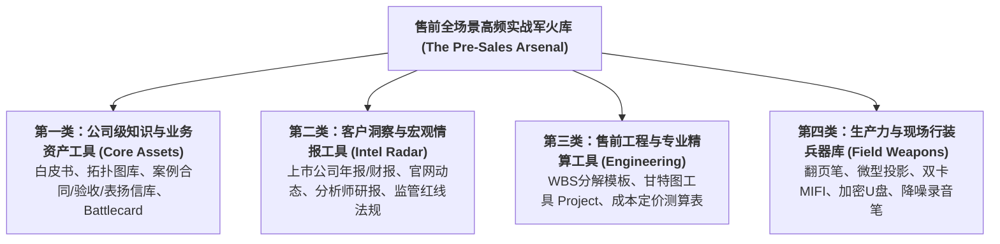

# 第56讲：售前日常高频作战支持工具箱与实战应用场景

> **【本讲一句话心法】**  
> 工欲善其事，必先利其器；平庸售前靠蛮力通宵搬砖，顶级售前靠精密武器库降维打击；构建覆盖“知识资产、客户洞察、工程精算与现场行装”的四维军火库，才是售前从游击队员跃升为正规军团的核心底蕴。

---

## 一、 场景痛点与认知破局

在日常售前高频作战中，很多售前工程师常常陷入一种极度低效且疲惫的**“重复造轮子恶性循环”**：

```
                ┌────────────────────────────────────────────────────────┐
                │          缺乏工具箱支撑的售前“四大低效窘境”                 │
                └────────────────────────────────────────────────────────┘
                                           │
         ┌───────────────────┬─────────────┴─────┬───────────────────┐
         ▼                   ▼                   ▼                   ▼
   【案例四处托人打听】 【架构图临时截图凑数】 【成本测算手撕公式】 【现场缺线少转接头】
   * 找合同关键页问三天 * 画张拓扑图耗时整天 * 没有标准 WBS 模板   * 现场投影接口不匹配
   * 客户要案例只能干等 * 格式模糊配色辣眼睛 * 漏项漏税率算错价格   * 关键时刻到处借排插
   * 错失响应黄金窗口期 * 客户第一眼判定山寨 * 报价失去竞争力或亏损 * 现场狼狈不堪形象尽毁
```

### 1. 售前缺乏标准化工具箱的三大内耗
* **内耗 1：资产碎片化，时间严重浪费在“找资料与求人”上**  
  公司明明在全国做过几十个类似大项目，但合同首页、验收报告和表扬信分散在各个销售个人的电脑里。每次客户要一份案例证明，售前必须在各大微信群里到处求爷爷告奶奶，甚至花三天时间还在等法务盖章扫描，严重拖垮了商机响应速度。
* **内耗 2：缺乏结构化洞察工具，只能看懂表层需求**  
  面对千亿级行业大客户，不知道从哪里获取其真实的战略考核指标。只会在客户IT人员面前问“你们需要什么功能”，完全读不懂客户上市公司年报背后的商业危机与监管部门强制下发的新合规红线，永远无法切入业务顶层。
* **内耗 3：现场硬件装备残缺，屡屡倒在“五毛钱的转接线上”**  
  到了客户高级会议室，才发现笔记本没有HDMI接口；投影仪在天花板上，自己的翻页笔没电；现场WiFi断网，自己没带备用随身MIFI。硬件细节的业余，直接毁掉了数周精心准备的高维方案汇报。

### 2. 认知破局：“售前武器库”是公司与个人的核心护城河
* **“磨刀不误砍柴工”**：一个装备齐全、训练有素的售前，其工作产出效率是一个缺乏工具箱新人的 **5倍到10倍以上**！
* **售前自己就是最好的工具设计者**：不要被动等待公司行政或市场部为你准备好一切。顶级售前在日常打仗中，**有意识地将每一次战斗沉淀为可复用的组件、模板、拓扑图源文件与攻防话术卡（Battlecard）**，逐步构建起属于自己、乃至赋能全团队的“实战军火库”！

---

## 二、 核心方法论与原理拆解

### 1. 售前实战高频作战支持工具“四大维度全景图”

一套完备、立体的售前作战工具箱，必须由四大维度严密搭建而成：



---

## 三、 售前实操标准动作（SOP / 打法步骤）

### 四大类别核心工具的实战应用场景深度拆解

#### 第一类：公司级知识与业务资产工具（核心武器库）
这是售前打赢日常方案战的基石，涵盖十二大高频资产：
1. **产品白皮书与规格表（Datasheet）**：严谨客观的技术规格说明书，为点对点应答提供底层佐证；
2. **行业解决方案通用模板**：按金融、制造、政务等行业封装的标准端到端方案框架；
3. **典型业务拓扑图库（Visio/SVG 矢量图源文件）**：高清、标准配色、组件模块化的架构图库，拖拽即可拼装出高颜值架构图；
4. **功能清单与特性矩阵（Feature Matrix）**：详尽罗列系统数百项功能点的层级清单，标明开箱即用度；
5. **配置报价工具（Configurator）**：自动化算力、存储与节点授权配置工具，输入业务量自动推算软硬件配额；
6. **全真演示环境（Demo System）与数据注入脚本**：随时可离线启动的轻量化业务系统，内置行业脱敏业务数据；
7. **演示/测试脚本模板（Demo & POC Script）**：精确到分秒的实操步骤与口播台词大纲；
8. **RFP 需求引导模板与投标方案模板**：针对不同竞品的控标条款库，与标准投标正文排版母本；
9. **客户案例列表与深度复盘长文（Case Studies）**：详尽列出同行业标杆客户清单及其建设成效；
10. **“吹牛凭证”三件套（合同首页复印件、验收报告、客户表扬信）**：破除客户信任防线的终极法律物理证据！
11. **销售实战指引（Salesplay）**：围绕某一新产品，向销售与售前宣贯的“目标客群、业务痛点、破冰切入点、开场话术”实战指引；
12. **竞品分析作战打法卡（Battlecard）**：详尽拆解主要友商的架构死穴、价格底线、我方短板的防守口径。

#### 第二类：客户洞察与宏观情报工具（战略透视雷达）
用于自上而下穿透客户高层战略，建立高维对话能力：
1. **上市公司公开年报与季报（Annual Reports）**：
   * 重点研读：**“管理层讨论与分析（MD&A）”**、**“董事长致辞”**与**“未来业务风险展望”**；
   * 提炼客户今年最焦虑的战略瓶颈（如降本增效、开拓海外市场、提升周转率），作为方案切入点；
2. **客户官方网站与领导公开演讲**：捕捉一把手近期的讲话高频词，在汇报PPT中精准引用领导原话；
3. **权威分析师行业研报（Gartner / IDC / Forrester）**：
   * 获取行业技术成熟度曲线（Hype Cycle）与市场份额报告，为方案前瞻性提供权威背书；
4. **国家与行业监管强制性法规（Regulatory Compliance）**：
   * 紧盯国家部委（如人民银行、国家能源局、工信部）最新发布的强制性安全与业务合规大纲，借合规大棒促成客户立项。

#### 第三类：售前工程与专业精算工具（理性骨架）
确保方案落地可行且商业盈利：
1. **WBS 任务分解表（Excel / MindManager）**：按模块与交付阶段，将需求精准分解至人天；
2. **项目工程排期工具（Microsoft Project / OmniPlan）**：生成包含关键路径（Critical Path）的标准甘特图；
3. **价格估算与成本核算模型（Pricing Sheet）**：内置人力矩阵、外采供应链、差旅与风险金公式的自动化财务精算单。

#### 第四类：生产力与现场行装兵器库（保命随身行囊）
售前奔赴现场交流与投标时，背包内必须常备的**“物理作战九件套”**：

```
  ┌────────────────────────────────────────────────────────────────────────┐
  │                 售前出征“物理随身背包”必带九件套                       │
  └────────────────────────────────────────────────────────────────────────┘
    1. 【多功能转接头坞】 必须同时具备 HDMI、VGA、Type-C 与网络 RJ45 接口。
    2. 【激光翻页笔】     检查电池电量，背包夹层常备一对全新 7 号碱性电池。
    3. 【双卡 5G 随身 MIFI】 电信/移动双网备用，抵御客户会议室断网与手机屏蔽。
    4. 【加密金属高速 U 盘】 存放免安装单机版演示镜像、标书 PDF 与汇报 PPT。
    5. 【专业高清录音笔】   用于调研与答辩现场录音（需经客户许可），便于精准复盘。
    6. 【深色签字笔与高级本】 交流现场握笔锚定防紧张，记录领导关键提问。
    7. 【便携微型投影仪】   在客户会议室无投影或设备损坏时，从容自救投射白墙。
    8. 【降噪耳机与眼罩】   出差高铁与飞机上快速补觉修整，保持巅峰脑力。
    9. 【便携装润喉糖】     连续演讲数小时咽喉沙哑时的救急生津良药。
```

---

## 四、 实战工具箱、话术与Checklist

### 1. 竞品作战打法卡（Battlecard）标准模板

```
========================================================================================
【售前实战打法卡 Battlecard】攻防目标：友商 K 公司（传统集中式方案老牌巨头）
密级：内部绝密资料               适用产品：新一代分布式数据中台           更新日期：2026年Q4
========================================================================================
【一、友商画像与核心卖点（知彼）】
 1. 核心卖点：品牌声誉响亮、市场成立时间长（15年）、宣称“全国上千家客户成功案例”。
 2. 销售套路：主打“老牌大厂安全可靠”，攻击我司为“初创新架构、案例少、缺乏长期验证”。
 3. 商务底线：通常首轮报价虚高，尾期为保单可降价 35%，惯用“低价中标、交付二次加价”。

【二、友商技术死穴与致命软肋（刺刀见红）】
 1. 架构老化单体强耦合：底层依然是十年前的集中式单体架构，无法真正实现弹性微服务水平扩容。
 2. 规则引擎封闭不透明：修改业务审批规则必须提工单给国外总部修改代码，响应周期长达数月。
 3. 信创国密兼容性硬伤：依赖国外商业数据库与专用操作系统，无法通过国家最新信创合规测评。

【三、客户面前降维打击话术与陷阱布设（攻防破局）】
 客户质疑点：“友商K公司说他们的系统最成熟，案例最多，你们怎么看？”
 售前标准应对口径：
 “K公司是业内令人尊敬的前辈，在信息化建设初期确实做出了巨大贡献。不过正如很多选择从K公司
  迁移到我司架构的标杆客户所总结的——过去的成功往往会成为今天业务创新的沉重包袱。
  传统的单体架构由于代码过于庞杂，导致今天改一个业务参数就需要两周的停机编译。
  而贵司未来三年的核心战略是业务敏捷创新，需要的是轻量化、自主可控的现代解法。
  建议在后续测试中，咱们可以增加一项‘在线动态无损热加载新业务规则’的现场实测对比！”
========================================================================================
```

### 2. 售前个人与团队工具箱成熟度自检 Checklist

> [!TIP]
> 每季度末必须完成的“售前兵器库成熟度评估”：
> - [ ] **“吹牛凭证”储备量**：手头是否已沉淀了至少 5 份同行业真实标杆合同首页与客户验收表扬信？
> - [ ] **拓扑图源文件库更新**：电脑本地是否建有按业务场景分类的高清 Visio/SVG 矢量图库？
> - [ ] **客户研读习惯建立**：在拜访任何年营收超10亿的企业前，是否已完整通读其最近一期的财报或行业监管报告？
> - [ ] **物理出征行囊核验**：双网卡MIFI、转接头、翻页笔电池是否处于随时拔包即可出征的战备状态？
> - [ ] **工具反哺组织意愿**：过去三个月，我是否将自己摸索出的某个优秀脚本或胶片，整理成了团队共享工具？

---

## 五、 真实标杆案例深度复盘

### 【案例背景】某千亿跨国车企数字化出海项目：随身工具箱化解毁灭性危机

* **情景 (Situation)**：某千亿级自主车企启动欧洲全渠道数字化营销与用户数据合规平台选型，项目预算1800万元。国内某自研软件领军厂商S公司受邀赴保定研发总部，向车企全球数字化副总裁、德国分公司总经理及首席法务官进行现场方案路演。
* **冲突 (Task)**：
  1. 现场连环硬件暴雷：会议室位于新建大楼地下保密室，完全屏蔽了手机4G/5G信号，且会场老旧大屏只提供老式VGA接口，S公司同行销售的超薄笔记本无法直连；
  2. 信任危机突发：外籍法务官对S公司提出极其尖锐的合规质疑：“你们如何证明你们这套自研系统完全符合欧盟 GDPR（通用数据保护条例）最苛刻的跨境数据假名化审计要求？中国软件企业很多在这里根本不合规！”
* **行动 (Action)**：
  1. **兵器库瞬间发挥神威**：
     * 主讲售前老谭不慌不忙，从随身作战背包中掏出“多功能金属扩展坞”，3秒内以VGA输出完美点亮大屏幕；
     * 从背包夹层取出自带的“双卡双待专网MIFI”，利用外接高增益天线成功穿透屏蔽网，平稳为演示工作站接入网络；
  2. **“吹牛凭证库”降维打碎合规质疑**：
     * 面对外籍法务官的苛刻质问，老谭没有空洞辩解；
     * 老谭打开笔记本中分门别类整理的《海外合规资产工具箱》，在大屏幕上瞬间调出三份极具杀伤力的物理证据：
       1. 德国莱茵TÜV出具的 GDPR 全球数据安全最高认证证书扫描件；
       2. 某欧洲排名前三的跨国汽车零部件巨头签署的合规终验报告脱敏页；
       3. 针对欧盟最新数据法案（Data Act）的《白皮书条款逐条对齐映射表》；
  3. **标准演示脚本行云流水**：老谭调出本地轻量化 Docker 离线镜像，严格按照备战多次的《GDPR数据匿名化实操脚本》，当场演示数据在0.1秒内完成不可逆哈希脱敏与跨境合规审计追溯。
* **结果 (Result)**：原本面色凝重、持怀疑态度的外籍法务官和德国总经理当场露出了难以置信的赞叹神情，法务官主动起身与老谭握手：“*Your preparation and documentation are extraordinary! You’ve completely resolved my deepest concerns.*”S公司凭借无懈可击的专业工具箱储备，以压倒性优势锁定该千亿车企出海一号工程！

---

## 六、 血泪教训与避坑红线

> [!WARNING]
> **红线 1：严禁直接向潜在客户提供带有上一家客户敏感商业机密的“未脱敏合同与文档”**  
> 在向客户展示“合同关键页”作为背书时，必须严格遵守保密法规！必须对上一家客户的公章细节、核心金额、非公开技术参数进行严密脱敏打码。如果不加脱敏就到处乱传别人家的原件，不仅属于严重的商业泄密违法行为，更会让当前客户感到极度不安，认定你是一个毫无保密底线的危险供应商！

> [!CAUTION]
> **红线 2：严禁对公司统一发布的标准配置工具与报价单“私自篡改公式”**  
> 很多初级售前自以为是，觉得公司标准配置工具推算出的硬件配置太高，为了迎合客户在Excel里私自删减内存或CPU核数。这种私自改动工具公式的行为，会导致交付期底层算力严重匮乏引发系统瘫痪，甚至导致公司必须自行贴钱补足硬件差价，酿成严重的商业事故！

---

## 七、 课后思考题与实战研讨指南

### 思考题 1
为什么在企业级B2B大单博弈中，“真实的合同首页、终验报告与客户表扬信”往往被公认为比上百页华丽的PPT更具击穿客户心智的杀伤力？如果你所在的业务线目前极度缺乏这些“硬核凭证”，作为领军售前，你该如何协同交付与销售团队，系统性建立起这套资产的持续沉淀与归档机制？

> **【实战研讨指引】**  
> * **心理击穿机制**：PPT是厂商的自卖自夸，属于主观宣称；而盖有公章的合同与验收报告属于**经受住法律与审计检验的客观历史事实**，直接瓦解客户对烂尾与欺诈的防御戒备；  
> * **沉淀机制三步走**：  
>   1. **将凭证归档纳入项目终验考核指标**：交付团队在拿到客户终验单与表扬信后，方可正式结项并计提奖金；  
>   2. **设立公司级“凭证安全保险库”**：由PMO统一进行法务脱敏，加盖防扩散水印，供售前按需在线调取；  
>   3. **建立表扬信撰写协助通道**：售前协助客户起草内容专业、用词规范的致谢公函初稿，方便客户领导顺畅签字盖章。

### 思考题 2
请检视你目前随身携带的电脑与通勤公文包，如果明天一早突然接到紧急通知，需要你立即飞往外地向一家百亿级集团客户的分管副总裁做一场生死攸关的项目技术汇报，你的工具箱中目前存在哪三项最致命的“短板或缺漏”？你计划在接下来的48小时内如何将它们彻底补齐？

> **【实战研讨指引】**  
> * **自我审视三项典型缺漏**：  
>   1. **物理外设缺位**：没有常备独立的双卡MIFI或多功能VGA转接头；  
>   2. **离线环境缺失**：本地没有搭建纯净的单机Docker脱机演示镜像，过度依赖远程公网；  
>   3. **客户战略洞察不足**：手头没有下载该客户最近一期的官方财报与行业监管新规；  
> * **48小时补齐计划**：购置全功能扩展坞与备用电池、配置本地单机沙箱环境、研读财报提炼3个高管痛点并植入开场白胶片。
