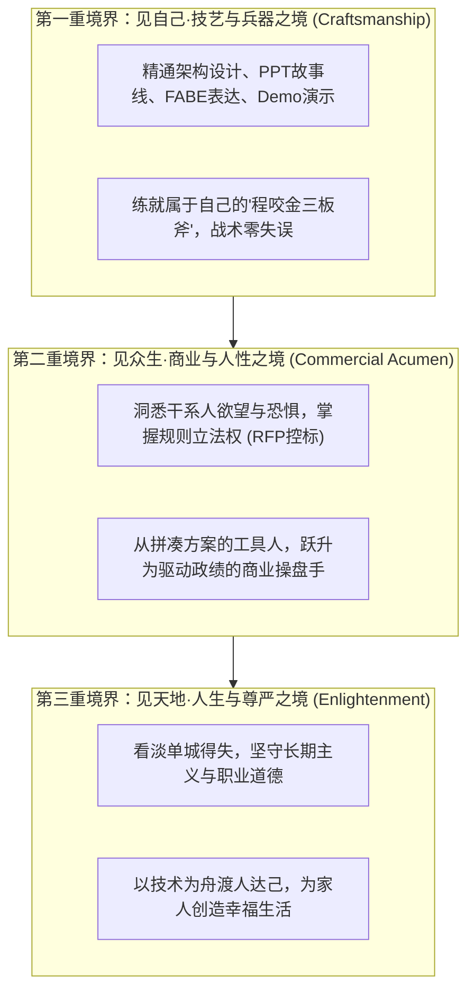
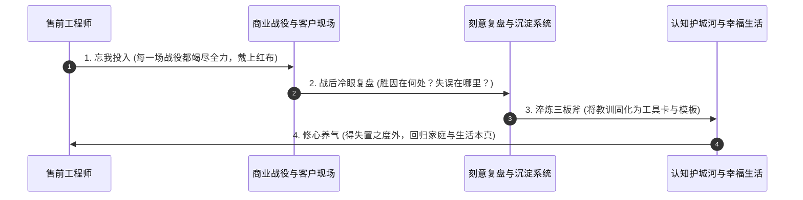

# 第57讲：寄语售前同行：长期主义、职业尊严与认知护城河

> **【本讲一句话心法】**  
> 滚滚长江东逝水，浪花淘尽英雄；是非成败转头空，青山依旧在，几度夕阳红。项目的成败与个人的沉浮不过是商业江湖的寻常浪花，但每一个售前为专业尊严所付出的深思筹谋，终将化作滋养家人与照亮人生彼岸的不灭基石。

---

## 一、 场景痛点与认知破局

在经历长达数十讲系统性知识与大单博弈战法的洗礼后，当我们跳出具体项目的战术泥潭，回到每一个售前工程师真实的生命体验中，往往会遇到一种深沉的**“职业困惑、身心倦怠与虚无感”**：

```
                ┌────────────────────────────────────────────────────────┐
                │          售前职业中后期的三大精神困境 (The Mid-Career Crisis) │
                └────────────────────────────────────────────────────────┘
                                           │
         ┌───────────────────┬─────────────┴─────┬───────────────────┐
         ▼                   ▼                   ▼                   ▼
   【得失心过重的焦虑】 【夹板气与工具人定位】 【方法论过载无从下手】 【人生价值的虚无感】
   * 赢单亢奋输单抑郁   * 销售嫌慢研发嫌烦   * 学了50多讲觉得太繁琐 * 几千万大单尘埃落定
   * 长期被业绩KPI绑架  * 功劳归销售背锅归售前* 面对实际项目手足无措 * 繁华散尽内心空虚
   * 身心俱疲难以自拔   * 怀疑自己能否干到退休* 陷入理论与现实的割裂 * 到底为了什么而奔波
```

### 1. 售前从业者的三大深层内耗
* **内耗 1：被单一项目的“成败得失心”严重反噬**  
  赢了一个大单，觉得老子天下第一；丢了一个跟了一年的项目，瞬间万念俱灰、怀疑自我。情绪被销售业绩的剧烈波动所绑架，长期处于高血压、失眠与焦虑的亚健康状态，丧失了内心的从容与宁静。
* **内耗 2：“夹板气”引发的职业尊严危机**  
  在销售面前，售前经常被当成随叫随到的“胶片美化工具”；在研发面前，售前常被看作“不懂底层实现的忽悠大师”；在客户面前，稍有不慎就被质疑“你们就是想掏我们预算”。售前两头受气，常常自嘲是“方案二把刀”，对职业未来充满迷茫。
* **内耗 3：“方法论过载”导致的瘫痪**  
  学完了整整50多讲的体系化知识，从6看尽调、SPIN提问、FABE、Storyline、POC控制到SOW和法律控标，有些售前反而觉得“规则太严苛、流程太繁杂、现实中根本用不上”，陷入畏难与退缩。

### 2. 认知破局：明代杨慎《临江仙》的心灵洗礼
明代文学家杨慎在名作《临江仙》中写道：  
> *“滚滚长江东逝水，浪花淘尽英雄。是非成败转头空。青山依旧在，几度夕阳红。白发渔樵江渚上，惯看秋月春风。一壶浊酒喜相逢。古今多少事，都付笑谈中。”*

在历史的长河中，秦皇汉武、合纵连横、商海沉浮，苦心孤诣之深厚，也不过是历史长河里翻滚的一朵小小浪花。
* **微观视角的真实不虚**：对于我们每一个普通而平凡的售前而言，项目的成败虽然转头空，**但如何让自己的事业有更好的发展、如何获得更高的薪酬改善家人的生活质量、如何在帮助客户解决难题的过程中收获职业尊严与成就感，却从来不是虚幻的，更不是转头空！**
* **“程咬金的三板斧哲学”**：  
  武功至深之时，万物皆可为利刃；而出入门槛，神功力浅，学全了也可能只伤人皮毛。天下没有包治百病的绝对神功！**全书50余讲的方法论，你不需要每一次都全盘打出。哪怕你真正吃透了其中一两招——哪怕只是把“FAB利益语言”用熟了、哪怕只是把“Storyline标题串讲”用透了、哪怕只是把“带解释的完全满足”做严密了——就像程咬金的三板斧，仅凭这三招，就足以让你在残酷的商业战场上击退强敌、立于不败之地！**

---

## 二、 核心方法论与原理拆解

### 1. 售前专业修行与认知进化的“三重境界”模型

一个顶尖售前的职业生涯，必然经历从“技艺”到“商业”、最终归于“人生修养”的三重蜕变：



#### ① 第一重境界：见自己（技艺与肌肉）
* 认识到自身的短板，戒骄戒躁；
* 将PPT排版、演讲控场、POC边界界定等基础动作训练为肌肉记忆；
* 形成不依赖运气、可稳定交付的标准化工作交付物。

#### ② 第二重境界：见众生（商业与人性）
* 走出纯技术的象牙塔，真正理解客户决策背后的政治诉求、体制考核与人性弱点；
* 懂得尊重盟友、协同销售、保护交付，用商业契约和法律思维编织防护网。

#### ③ 第三重境界：见天地（长期主义与心流）
* 拥有“胜固欣然，败亦从容”的豁达胸襟；
* 将售前工作视作锻炼心智、增广见闻、回馈社会的道场；
* 不为短期浮利放弃职业操守，用时间复利铸就不可动摇的个人声誉壁垒。

---

## 三、 售前实操标准动作（SOP / 打法步骤）

想要成为一名能够“干到退休、受人尊敬”的长青售前专家，必须坚持践行以下四大习惯：



### 习惯1：每一场战役，竭尽全力，毫无保留
* 无论面对多小的项目、无论面对多么苛刻的客户，只要决定迎战，就亲手戴上“红布”，以100%的热情与专业去准备；
* 做到“流水不争先，争的是滔滔不绝”。哪怕输了，也让客户和对手看得到你无可挑剔的专业苦劳。

### 习惯2：胜败之后，关门冷眼复盘（AAR - After Action Review）
* 绝不在庆功宴的狂欢中迷失，也绝不在失败的宿醉中消沉；
* 每次战役结束后48小时内，关上门自问三个问题：
  1. *这次成功，有多少是靠真正的技术方案胜出？有多少是靠运气或关系？*
  2. *这次失误，最致命的短板暴露在哪个阶段（是需求没摸清，还是控标没控住）？*
  3. *我能从中提炼出哪一项可以复用的工具或话术卡？*

### 习惯3：做属于自己的“工具匠人”，沉淀个人军火库
* 将平生所学精炼为随身携带的“三板斧”；
* 建立私有的案例凭证库、拓扑图库与竞品攻防卡，让经验在岁月里持续产生复利。

### 习惯4：守住底线，善待自己与家人
* 售前工作的核心目的是为了“改善生活、成就家人”，绝不是为了透支健康去追求虚名；
* 守住法律与合规底线，坚决不参与任何违规串标与商业贿赂；
* 走下讲台、合上电脑，把最好的耐心与微笑留给父母、伴侣和孩子。

---

## 四、 实战工具箱、话术与Checklist

### 1. 售前工程师长青职业素养雷达评估卡

| 维度 | 优秀表现（长青专家） | 危险表现（早衰与倦怠） | 改进策略与心法 |
| :--- | :--- | :--- | :--- |
| **技术敏感度** | 持续关注行业代际演进，懂业务语言，能降维解释底层原理。 | 故步自封，沉迷十年前老技术，满嘴技术黑话自嗨。 | 每季度精读两份国家级新监管政策与行业白皮书。 |
| **商业敏锐度** | 懂财务人月、懂SOW法律边界、懂用技术分拉开价格溢价空间。 | 只管画架构图，认为价格和合同都是销售的事，对成本麻木。 | 深度研读第49讲SOW与第50讲成本核算，像商人一样思考。 |
| **情商与同理心** | 善于倾听客户弦外之音，台上给专家留足面子，台下助盟友立功。 | 傲慢好辩，当众纠正客户，赢了口舌辩论却输了整场战役。 | 牢记“柔和而坚定”；客户不是被辩驳服的，而是被理解服的。 |
| **心理抗逆力** | 胜不骄败不馁，视挫折为成长养分，始终保持充沛笃定气场。 | 输单怨天尤人甩锅研发，遇到打压一蹶不振，严重内耗。 | 常思杨慎《临江仙》；成败是常态，专业积累才是永恒资产。 |

### 2. 售前同行心灵守护 Checklist

> [!TIP]
> 当你在某个深夜感到身心俱疲、怀疑职业意义时，请静下心核对以下五条“定心指针”：
> - [ ] **努力问心无愧**：在刚刚过去的战役中，我是否已经做到了当前认知和资源下的极限？
> - [ ] **能力资产留存**：即使单子没拿下来，我是否掌握了一个新行业的业务逻辑？我的方案库是否又新增了一份高质量沉淀？
> - [ ] **客户信任留存**：在整个交流中，我展现出的严谨与敬业，是否让客户的某位骨干在心里默默为我点赞？
> - [ ] **底线安然无恙**：我是否守住了合规底线，今晚能否安然入眠、不惧任何审计与纪检调查？
> - [ ] **生活回归本真**：明天太阳照常升起，我是否留出了陪伴家人、吃一顿热饭的从容时光？

---

## 五、 真实标杆案例深度复盘

### 【案例背景】一位二十余年售前老兵的职业复盘：从“技术极客”到“灯塔领军者”

* **起点 (The Beginning)**：2003年，老陈刚从大型软件公司的一线程序员转岗售前。当时的他满嘴都是C++、多线程、底层寄存器与数据库游标。在一次面向省级电力局长的重要汇报中，老陈洋洋洒洒讲了一个半小时内存管理机制，局长在第20分钟便拂袖而去，项目当场宣布丢单。老陈痛苦万分，觉得“这帮不懂技术的外行根本配不上我的先进架构”。
* **觉醒 (The Awakening)**：
  1. **一位老外企销售总监的棒喝**：老陈当时的销售导师指着他的鼻子说：“老陈，客户买的不是你的编译器，买的是电网在大年三十晚上不跳闸、买的是老百姓家里有电！你如果连局长心里的焦虑都听不懂，你写再多代码也就是个码农！”；
  2. **褪去傲慢，修炼“三板斧”**：老陈从此收起技术傲慢，开始钻研商业与财务：
     * 他花了三年时间精研 **FABE利益语言**，学会把每一项技术参数翻译成管理成效；
     * 他潜心打磨 **Storyline 标题串讲法**，每份胶片在白板上反复推演逻辑；
     * 他深耕 **SOW 边界艺术**，带领交付团队在数千个复杂工程中无一例因边界不清引发索赔；
* **升华 (The Mastery)**：
  * 到了2015年，老陈已成长为行业首席售前总监。在面对某国家级能源骨干网数十亿重大工程选型时，面对竞争对手狂风暴雨般的高层关系公关与恶性降价倾销，老陈没有焦虑。他凭借对能源安全法规的深刻穿透，协助国家主管部委起草了行业新一代高可用准入标准，从顶层彻底锁死胜局；
  * 中标之后，老陈没有居功自傲，而是手写了整整十封感谢信，逐一呈送给支持过他的各级干部，随后默默协助现场项目经理完成了长达两年的平稳交付。
* **回首 (The Reflection)**：如今老陈已年过半百，退休前夕，当年轻售前向他请教“售前最核心的秘诀是什么”时，老陈微笑着指了指窗外的长江：“小伙子，没有什么秘诀。**不过是心中有敬畏、手里有准绳、凡事尽本分。把别人的事情当成自己的事情办，把虚幻的输赢看淡一点，把身边的兄弟和家人的幸福看重一点。做到这几条，你就能在这个岗位上干得堂堂正正、心安理得！**”

---

## 六、 血泪教训与避坑红线

> [!WARNING]
> **红线 1：严禁因贪图短期成败而踏入“商业贿赂与违法串标”的万劫不复深渊**  
> 永远记住：没有任何一个项目值得你用自己的自由、尊严与家庭去下注！无论销售如何诱惑、无论外界环境如何泥沙俱下，售前必须守住干干净净的技术与方案底线。靠歪门邪道赢下的单子，终究会在未来的某一天成为射向自己的利箭！

> [!CAUTION]
> **红线 2：严禁陷入“技术虚无主义与彻底躺平”**  
> 看淡得失是指在战略上拥有豁达的胸怀，**绝不等于在战术上随波逐流、敷衍了事、应付差事！** 如果把“是非成败转头空”当成自己不写方案、不改PPT、不核对标书的懒惰借口，那么你不仅得不到内心的宁静，更会被残酷的职场竞争迅速淘汰出局！

---

## 七、 课后思考题与实战研讨指南

### 思考题 1
回首整整57讲的漫长学习之旅，在所有的售前方法论（包括心法、4S模型、6看尽调、SPIN提问、FABE语言、Storyline故事线、POC控制、SOW边界、RFP控标等）中，哪“三板斧”是真正触动你内心、且最适合你在接下来三个月内重点突破并转化为本能肌肉记忆的？

> **【实战研讨指引】**  
> * **个性化定位建议**：  
>   * *技术极客转售前者*：优先选【FABE利益语言】+【Storyline标题串讲】+【Demo捞干货上硬菜】；  
>   * *打单期瓶颈售前者*：优先选【6看尽调】+【Champion暗线维护】+【深度控标RFP与评分设计】；  
>   * *架构师与带队总监*：优先选【SOW律师级边界界定】+【精密成本WBS测算】+【Handover交付交接白皮书】；  
> * **践行策略**：弱水三千取一瓢饮，先在下一个真实项目中把这三招打磨到极致。

### 思考题 2
当你下一次在重大技术交流或开标现场，不幸遭遇了令人沮丧的失利或不公的丢单时，你将如何运用本讲的心灵哲学与复盘机制，在最短的时间内完成自我情绪救赎，并带领身边的战友重整旗鼓、从容迎战下一场战役？

> **【实战研讨指引】**  
> 1. **物理隔离负面情绪**：战役结束当晚，严禁内部开批斗甩锅会；带团队吃一顿热气腾腾的火锅，举杯向所有人的辛苦付出致敬，宣泄压力；  
> 2. **客观归因与资产萃取**：48小时后，理性复盘失败的技术盲区，将教训转化为《避坑案例库》，让每次学费都不白交；  
> 3. **心境升华重构**：默念“青山依旧在，几度夕阳红”；收拾行囊，戴上红布，以更成熟、更锋利的姿态，从容奔赴下一个山海！
