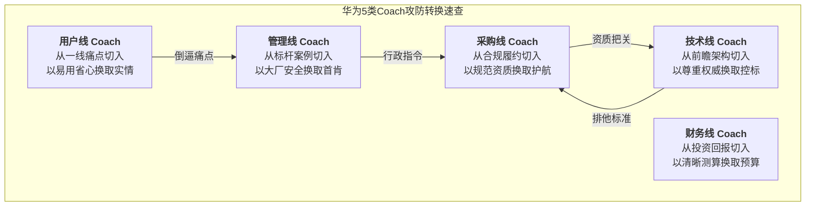

# 附录B：4S专业售前核心方法论速查卡片

> **【使用说明】**  
> 本速查卡片为“售前高频作战速查手册（Cheat Sheet）”，汇聚全书 57 讲中最核心的思维模型、话术公式、避坑金句与战术决策树。建议存入手机或打印随身携带，在走向客户现场、登台演讲、或闭门商务博弈前快速扫读，瞬间拉齐思维峰值。

---

## 核心基石：4S 专业售前进化阶梯

```
  ┌────────────────────────────────────────────────────────────────────────┐
  │                   4S 专业售前方法论成长阶梯全景蓝图                      │
  └────────────────────────────────────────────────────────────────────────┘
    Level 4: 【Success 领军售前】 —— 商业领袖，把握战略大势，助客户与公司共赢
    Level 3: 【Strategy 战术售前】—— 攻防谋略，深度控标，以技术撑商务锁定溢价
    Level 2: 【Specialist 专家售前】— 场景穿透，不仅画大饼更能做落地面条
    Level 1: 【Support 支撑售前】 —— 功底扎实，守住合规底线，杜绝低级失误
```

---

## 卡片一：商机初筛与需求开发（建立需求阶段）

### 1. 商机穿透“6看尽调模型”
* **一看背景**：是核心生产痛点，还是为了花完预算的面子工程？
* **二看预算**：是否正式列入今年财务预算表？预算代码与金额是否清晰？
* **三看决策人**：谁签字报销（Sponsor）？谁主导选型（CIO）？谁是业务PO？
* **四看竞争**：友商何时介入？是否已深度控标？我们是否有差异化切入点？
* **五看可行性**：上线工期是否违背工程规律？自研产品匹配度是否超70%？
* **六看沉没成本**：若赢单概率 $<30\%$ 且缺乏破局点，**立即止损弃赛（No-Go）**！

### 2. SPIN 顾问式提问引导技术
```
  [S] 现状问题 (Situation) ──► "贵司目前多工厂协同目前主要采用什么方式？"
            │
            ▼
  [P] 难点痛点 (Problem)   ──► "月末统计跨区域库存时，经常出现数据延迟或对账不平吗？"
            │
            ▼
  [I] 隐含影响 (Implication)─► "这种延迟是否导致过干线货车空驶？每月因此产生的损失大概多少？"
            │
            ▼
  [N] 价值需求 (Need-Payoff) ─► "如果有一套系统能在3秒内实时推演最佳调拨路径，对您意味着什么？"
```

### 3. 独特卖点（USP）黄金铁三角
$$\text{杀手级 USP} = \text{客户痛点极度关切} \cap \text{我方技术绝对独占} \cap \text{主要竞品无法比拟}$$
* *心法*：没有完美的产品，只有在特定业务场景下不可替代的攻防护城河。

---

## 卡片二：方案宣讲与演示控场（技术评估阶段）

### 4. FABE 利益陈述转换公式
```
  F (Feature 特性)  ──► "我们采用跨城三中心双活高可用架构"
        │
        ▼ 桥梁词：【这意味着 / 能够做到】
  A (Advantage 优势)──► "当任意城市机房遭遇断电时，系统在2秒内无损倒换"
        │
        ▼ 桥梁词：【对您而言直接带来 / 能够帮您】
  B (Benefit 利益)  ──► "彻底满足银保监合规要求，保障核心对公业务零中断，护航您的年终绩效"
        │
        ▼ 证据闭环：【正如业界权威实践】
  E (Evidence 证据) ──► "这是某国有大行生产运行3年的测评报告与工信部信创认证"
```

### 5. Storyline（故事线）标题串讲法则
* **外企导师绝招**：每页PPT的标题必须是一句**完整的论断句（动宾结构/观点句）**；
* **巡检标准**：在大纲视图下，只读每页标题，逻辑必须行云流水、环环相扣；
* **莎士比亚卖钢笔范式**：认可地位 -> 行业共性痛点 -> 痛点拆解(1/2/3) -> 理想工具画像 -> 收益呈现(1/2/3/4) -> 行动呼吁。

### 6. 演示（Demo）墨菲定律三道防线
* **第一道防线**：本地单机 Docker 脱机闭环（拔掉网线也能跑）；
* **第二道防线**：Golden Snapshot 虚拟机黄金快照 + 一键重置脚本；
* **第三道防线**：4K 高保真无剪辑端到端实操录屏（终极保命替身）。

### 7. 现场答辩异议处理（Objection Handling）四步法
1. **缓冲接纳**：“感谢专家极具深度的问题，切中了分布式系统的核心痛点……”
2. **标书索引**：“正如我们在技术标书第 185 页 3.4 节所详细推导的……”
3. **数据佐证**：“我们在某标杆客户实测中，该机制已平稳运行三年，时延仅1.8秒……”
4. **谦逊请教**：“进场后，我们非常期待就具体边界参数向专家进一步请教！”

---

## 卡片三：招投标、SOW与商务博弈（招标采购阶段）

### 8. 点对点应答“带解释性完全满足”公式
```
  【应答】：完全满足。
  【详细说明】：
  1. 我司 XX 产品符合 ISO9001 质量标准，具备高可靠设计。
  2. 【界定客观标准】：我方理解并承诺该指标的技术判定标准为：在标准工况下水温稳定在90℃以上。
  3. 【设定时间与边界】：自终验之日起10年内提供原厂质保；若有缺陷免费修复并顺延2倍故障时长。
  4. 【设定极端上限】：为保障工程确定性，累计顺延服务期最长不超过 5 年。
```

### 9. SOW 工作说明书最值钱的防火墙——Out-of-Scope
* **刚性排除项**：
  * 排除历史脏数据的人工清洗与纠错；
  * 排除第三方遗留系统的接口代码开发与改造费用；
  * 排除底层商业数据库/操作系统的商用授权采购费；
  * 排除机房现场弱电布线与土建施工工程。
* **逾期默示认可**：“甲方收到成果物后 5 个工作日内未出具书面异议，依法视为验收通过。”

### 10. 评分标准“区分度设计”原则与评标模拟
* **三不陷阱**：杜绝全满足（废项）、杜绝全不满足（死题）、必须追求“梯级断层”；
* **用技术撑商务公式**：
  $$\Delta \text{技术分优势} = \text{我方技术得分} - \text{主要竞品技术得分} \ge 10 \sim 15 \text{分}$$
  $$\Downarrow$$
  $$\text{技术分代差足以吸收友商 } 20\% \sim 30\% \text{ 的恶意低价冲击，锁定高溢价中标！}$$

### 11. 项目成本全要素精算（PERT）模型
* **三点估算期望工时**：$E = \frac{O (\text{乐观}) + 4M (\text{可能}) + P (\text{悲观})}{6}$
* **全成本六大必算项**：直接人月工时 + 外采供应链税差 + 异地差旅驻场 + **5%~10%风险准备金** + 质保金资金利息 + 公司税金公摊。

---

## 卡片四：交付传承与后周期深耕（签约交付阶段）

### 12. 项目交付交接（Handover）四维全息白皮书
* **一维·法律商务**：中标通知书、合同正本、分项报价明细、SOW终稿。
* **二维·技术工程**：技术标书终稿、点对点应答底稿、POC测试见证单、架构源文件。
* **三维·干系人雷达**：谁是 Champion、谁是暗桩、领导脾气、处室利益冲突（最值钱！）。
* **四维·口头承诺备忘**：答应过的次要小调整、已识别的老系统隐藏技术坑。

### 13. 维保期商机孵化闭环（Land & Expand）
```
  日常慢查询/报障工单 ──► 识别业务演进瓶颈 (而非当作普通Bug)
           │
           ▼
  每半年呈递《系统运行深度体检与健康评估报告》 ──► 敲响容量饱和警钟
           │
           ▼
  协助 Champion 编制二期立项请示 ──► 论证《系统一致性与单一来源采购》
           │
           ▼
  避开公开招标红海竞争，锁定千万元级增购大单！
```

---

## 售前出征保命口诀

> **红布蒙眼信产品，FABE讲利益；**  
> **标题串讲故事线，捞干上菜莫自嗨；**  
> **克制进场控测试，一页看板定高层；**  
> **完全满足加解释，律师笔法写范围；**  
> **逆向倒排留缓冲，致谢盟友交接清；**  
> **日常工单挖增购，长青之道在敬畏！**


---

## 十一、 卡片 11：华为市场洞察“5看”与拓展“8法”实战矩阵

### 1. 华为市场洞察“5看”操作要义
* **看行业/趋势**：政策规制导向、技术迭代周期、宏观信创/安全合规要求。
* **看市场/客户**：锁定指名大客户名单、画出行业组织地图、洞察核心业务痛点。
* **看竞争**：摸清主要竞品报价区间、代理商阵容、方案优势与致命技术死穴。
* **看自己**：审视产品硬核成熟度、交付与服务保障力、团队跨区域协同作战能力。
* **看机会**：识别战略机会窗，把优势能力精准对准客户的急迫痛点。

### 2. 华为市场拓展与情报获取“8法”速查
1. **行业报告法**：采购权威数据报告，快速建立宏观规模与市场份额框架；
2. **网络深搜法**：多关键词组合深挖（招投标公告、中标公示、友商软文与招聘动向）；
3. **行业咨询法**：访谈本地咨询顾问，借智梳理区域代理商阵营与地盘格局；
4. **协会商会法**：联合行业协会/商会开展小赞助活动，低成本批量触达精准决策者；
5. **政务研读法**：研读政策文件与补贴申报指南，预判项目立项与真实预算；
6. **展会论坛法**：设立专业技术展台，在行业峰会一线倾听客户原声顾虑；
7. **竞品圈子法**：追踪友商生态合作伙伴培训与自媒体技术白皮书，研判其攻守策略；
8. **专业社群法**：扎根技术开源社区与行业运维交流群，掌握一线真实体验槽点。

---

## 十二、 卡片 12：华为客户关系三层次（普遍/关键/组织）体检表

| 客户关系层次 | 核心对象与角色 | 运作特征与战略目标 | 检查指标（Yes / No） |
| :--- | :--- | :--- | :--- |
| **普遍客户关系**<br>(底层地基) | 秘书、助理、基层技术员、运维人员、基层网管。 | **易接触、易突破、易成同盟**。<br>掌握领导日常偏好、真实采购隐情、友商拜访轨迹；防范关键领导调离产生信息真空。 | [ ] 至少建立了5个以上基层信息触点<br>[ ] 摸清了客户内部对老系统的主要抱怨<br>[ ] 与一线人员保持每周低频良好沟通 |
| **关键客户关系**<br>(决胜胜负手) | 业务分管领导（EB）、技术总工（TB）、招投标处长。 | **决定项目生杀大权**。<br>主导技术方案偏离要求、拟定招标文件评分表、把控专家抽取与答辩流程。 | [ ] 明确了技术指标的核心主导起草人<br>[ ] 锁定了至少1个独家排他性USP加分项<br>[ ] 获得关键决策人对方案确定性的首肯 |
| **组织客户关系**<br>(高维护城河) | 双方高层管理团队、行销对行销、研发对研发。 | **平台化沉淀，摆脱个人依赖**。<br>分层分类对接，举行年度技术颁奖，共建联合创新中心（JIC）与战略协议。 | [ ] 双方管理高层建立了互访对接机制<br>[ ] 推动了面向客户技术骨干的荣誉表彰<br>[ ] 在公司平台沉淀了完整的项目档案资料 |

---

## 十三、 卡片 13：华为五类关系人 Coach 发展与攻防博弈矩阵



### 5类关系人Coach发展口诀：
* **用户线**：`多跑一线听抱怨，基层减负是关键；小礼虽薄心意真，真实内情全抖全。`
* **技术线**：`方案先进重权威，架构资料提前给；锁定指标设暗桩，标书一出谁能违。`
* **管理线**：`领导底线是不乱，品牌背书除风险；同业案例拿出来，政绩安全把心安。`
* **采购线**：`招标合规按流程，资质业绩要完整；评委规则问明白，权重倾斜赢大成。`
* **财务线**：`预算额度先探准，付款周期算得分；守信履约财务稳，资金到位不卡顿。`
