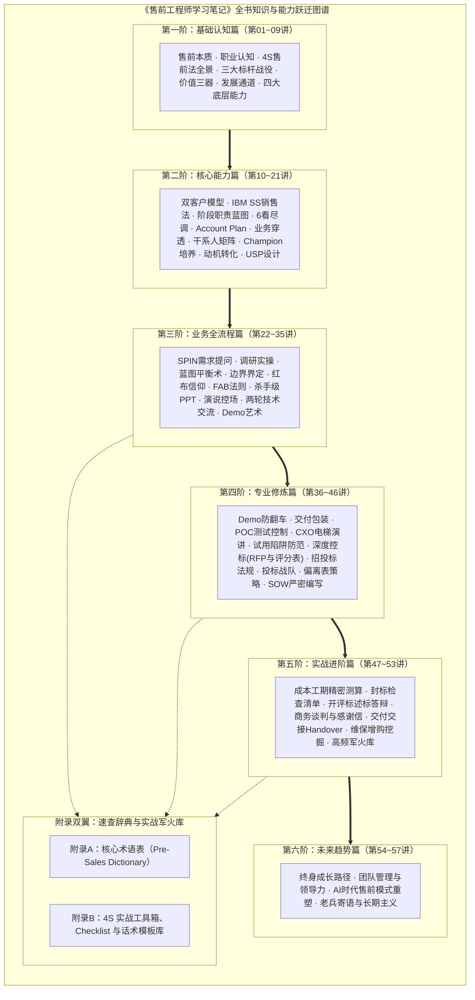

# 《售前工程师学习笔记 (Pre-Sales Bible)》全书全量内容大纲与知识地图

> **主旨定位**：从技术实现到商业闭环——用 4S 咨询思维与全流程作战体系打造顶级解决方案专家  
> **核心方法论**：4S 专业售前法（Selling Orientation, Customer Success, Solution Engagement, Showcase Value）$\times$ IBM SS 复杂项目销售体系  
> **语料来源**：赵成栋（CD老师，前 IBM / HP / 思科 / BMC 资深售前总监，《精通售前》译者）57篇实战录音精萃

---

## 一、 全局架构演进图（六阶火箭进阶模型）

---

## 二、 篇章核心知识拆解与能力产出

### 第一篇：基础认知篇（建立职业自豪与底层心法）
* **核心目标**：打破纯技术研发思维惯性，建立售前职业认同，理解“为什么售前是兼具商业智慧与技术深度的复合型专家”。
* **关键产出**：
  * **4S专业售前法**：以销售为导向（Selling Orientation）、助力客户成功（Customer Success）、方案驱动契合（Solution Engagement）、展现无可挑剔的价值（Showcase Value）。
  * **售前三大价值定位**：业务价值的“显示器”（让技术可见）、“桥接器”（跨越商业鸿沟）、“放大器”（倍增方案 ROI）。
  * **三大标杆战役**：单一来源反转战、技术保卫上市战、USP 差异化绝杀战。
  * **底层四大能力**：商业洞察力、方案架构力、演讲控场力、同盟整合力。

### 第二篇：核心能力篇（商机尽调、干系人经营与USP设计）
* **核心目标**：从商机发掘切入，掌握销售方法论与客户内部复杂政治/利益图谱的解构技术。
* **关键产出**：
  * **服务对象双模型**：内部第一客户（销售搭档）与外部多层级客户的诉求对齐。
  * **IBM SS 方法论实战**：商机管道阶段划分与各阶段售前进入/退出门禁（Gating）。
  * **“6看”尽调战术**：看背景、看财报、看组织、看现状、看痛点、看预算。
  * **干系人与政治权力图谱**：决策者（EB）、技术把关者（TB）、实际使用者（UB）、内部支持者（Champion）、项目发起人（Sponsor）。
  * **独特卖点（USP）九宫格**：在“客户需要”、“自身具备”、“友商无法提供”的交集区构筑不可替代的技术壁垒。

### 第三篇：业务全流程篇（需求引导、方案打磨与首轮攻防）
* **核心目标**：全面覆盖从第一次拜访到方案交流、演示的全生命周期互动。
* **关键产出**：
  * **SPIN 提问法则**：现状问题（S） $\to$ 难点痛点（P） $\to$ 影响后果（I） $\to$ 价值收益（N）。
  * **“画饼与做面”平衡术**：既有引领未来 3~5 年的宏观蓝图（画饼），又有一期切实可落地的扎实技术路径（做面）。
  * **FAB 转换模型**：属性（Feature） $\to$ 优势（Advantage） $\to$ 客户收益（Benefit）。
  * **杀手级 PPT 六段式结构**：痛点共鸣 $\to$ 愿景蓝图 $\to$ 方案架构 $\to$ 核心差异化 $\to$ 成功案例 $\to$ 交付实施保障。
  * **两轮技术交流节奏把控**：首轮“展示肌肉，保留底裤”，二轮“对焦击穿，亮剑锋芒”。

### 第四篇：专业修炼篇（Demo演示、POC控制、深度控标与SOW）
* **核心目标**：攻克售前打单中最容易“翻车”和被“白嫖”的高风险深水区。
* **关键产出**：
  * **Demo 容灾三原则与防翻车 Checklist**：环境隔离、离线兜底、剧本预演。
  * **POC 控制六步法**：准入评审 $\to$ 测试用例锁定 $\to$ 周期锁定 $\to$ 环境验收 $\to$ 报告签字 $\to$ 成果挂钩商务。
  * **CXO 汇报“电梯演讲”结构**：30秒定痛点，60秒给方案，90秒算投资回报率（ROI）。
  * **深度控标“四维锁定法则”**：独家资质参数引导、加分项精准设伏、方案评分标准倾向性设计、废标红线布防。
  * **SOW 编写的“律师级”护栏**：明确项目范围边界、交付物规格、验收准则、双方权责与免责除外条款。

### 第五篇：实战进阶篇（招投标、开标答辩、商务谈判与交付交接）
* **核心目标**：打赢临门一脚的攻坚战，并在签约后实现与交付团队的安全交接和增购培育。
* **关键产出**：
  * **成本、工期与风险精密测算模型**：人月成本、第三方软硬件、实施交付风险准备金核算。
  * **封标审查 18 项防废标清单**：盖章、法人签字、资质原件、响应偏离等致命细节严控。
  * **评标现场述标与攻防答辩**：时间掌控策略、专家异议化解法、友商挑刺反制话术。
  * **交付交接（Handover）五项移交清单**：原始需求单、SOW确认版、干系人政治图谱、未兑现的技术承诺备忘录、风险提示函。

### 第六篇：未来趋势篇（职业跃迁、团队管理与 AI 赋能）
* **核心目标**：指明售前工程师在数字化与智能化浪潮下的成长方向与战略制高点。
* **关键产出**：
  * **售前成长“三级跳”**：技术专家 $\to$ 解决方案专家 $\to$ 商业咨询合伙人。
  * **数字化与 AI 时代的新一代售前范式**：知识库助手、自动化标书审查、AI 辅助竞品情报分析与多模态 Demo 快速生成。
  * **售前老兵守则**：守住职业诚信底线，保持长期主义，永远对技术创新与商业规律心存敬畏。

---

## 三、 全书篇章与讲座对照表

| 篇章编号 | 篇章名称 | 对应讲次 | 文档位置 | 重点核心知识点 |
| :--- | :--- | :--- | :--- | :--- |
| **00** | 全书总览与知识地图 | 导论 | `00_总览与知识地图.md` | 全书知识拓扑、学习路线、速查索引 |
| **01** | 售前心法与成功基石 | 01~05讲 | `01_第一篇_售前心法与成功基石/` | 4S模型、三大战役、USP设计、进化路径 |
| **02** | 售前岗位再认知与方法论 | 06~12讲 | `02_第二篇_售前岗位再认知与方法论/` | 摆脱二把刀、价值三器、IBM SS、阶段职责蓝图 |
| **03** | 建立需求阶段实战指南 | 13~26讲 | `03_第三篇_建立需求阶段实战指南/` | 6看尽调、干系人矩阵、同盟军Champion、SPIN提问、蓝图平衡术 |
| **04** | 技术评估阶段实战指南 | 27~43讲 | `04_第四篇_技术评估阶段实战指南/` | FAB法则、两轮交流、Demo防翻车、POC控制、深度控标 |
| **05** | 招投标与后周期实战指南 | 44~56讲 | `05_第五篇_招投标与后周期实战指南/` | 投标战队、偏离表艺术、严密SOW、封标清单、述标答辩、Handover |
| **06** | 职业进化与实战军火库 | 57讲 + 附录 | `06_附录与售前实战军火库/` | 长期主义、全流程Checklist总表、4S方法论速查卡片库 |

