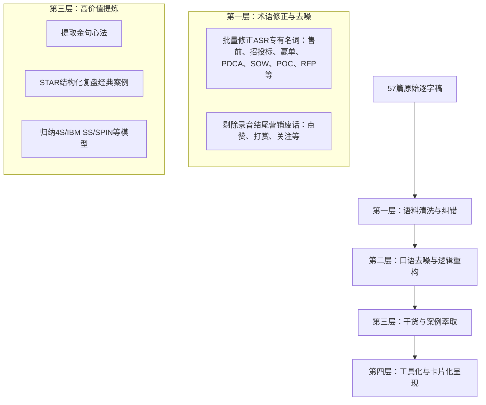
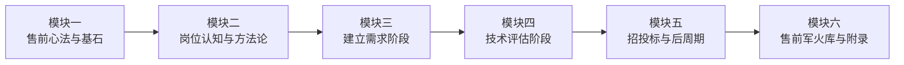

# 《售前工程师实战宝典学习笔记》产品需求文档（PRD）

> **文档状态**：已评审并归档执行  
> **核心语料**：赵成栋（CD老师，前IBM/HP/思科/BMC售前老兵，《精通售前》译者）《4S专业售前法：从入门到精通》57篇课程逐字稿  
> **产出目标**：将口语化、高噪点的音频逐字稿萃取重构为体系化、可实操、直击打单痛点的《售前实战知识库与打法百科（Pre-Sales Playbook / Bible）》

---

## 一、 产品定位与核心价值

- **不是简单的“文本摘要”**：原始逐字稿存在大量 ASR 语音识别错误（如“授钱”->“售前”、“招图标”->“招投标”、“营单”->“赢单”等）、口语停顿与冗余套话。
- **定位为“实战打法百科（Playbook）”**：
  1. **体系性**：横向贯通商机培育、需求引导、技术评估、招投标、合同签约到交付交接全生命周期；
  2. **工具化**：把讲师 20 余年的隐性经验转化为显性化 SOP、Checklist 清单、话术范例与决策矩阵；
  3. **战斗力**：直面一线复杂商业博弈（防止被销售当枪使、防被客户白嫖 POC、反制友商控标、写出严谨合规的 SOW 等）。

---

## 二、 目标受众与痛点矩阵

| 目标角色 | 核心痛点与困境 | 预期获得的价值 |
| :--- | :--- | :--- |
| **转岗新手**<br>(研发/实施/测试转售前) | 纯技术视角、不敢开口见客户、被销售指挥得团团转、不知如何提炼价值 | 建立售前职业认同，完成从“讲功能”到“讲业务价值”的思维蜕变，提供沟通范式。 |
| **初中级售前**<br>(1~3年一线打单售前) | 技术交流抓不住痛点、PPT平铺直叙、演示翻车、POC被客户拖垮、标书写成拼盘 | 掌握干系人识别与Champion同盟培养、两轮技术交流控场、深度控标（影响RFP与评分表）技巧。 |
| **资深售前/架构师**<br>(3~8年打单骨干) | 陷入低价竞争、不知如何借USP翻盘、交付阶段与交付团队频繁扯皮 | 掌握不可替代 USP 设计法、顾问式蓝图规划平衡术，编写“像律师一样严密”的 SOW。 |
| **售前管理者/团队负责人** | 团队野蛮生长、打单各凭运气、缺乏体系化赋能教材与统一规范 | 统一团队 4S 打单作业语言，作为团队新人训战手册与打单复盘规范。 |

---

## 三、 语料输入处理与清洗策略



1. **专业术语标准化纠错表（词典映射）**：
   * `授钱` $\rightarrow$ `售前`
   * `招图标 / 招投标` $\rightarrow$ `招投标`
   * `营单` $\rightarrow$ `赢单`
   * `保典` $\rightarrow$ `宝典`
   * `PTC` $\rightarrow$ `PDCA循环`
   * `Unpremises` $\rightarrow$ `On-premises（私有化部署）`
   * `大东华区` $\rightarrow$ `大中华区`
   * `大名鼎鼎的IBM SS` $\rightarrow$ `IBM Signature Selling Method (SS销售方法论)`
2. **去口语化与书面结构化**：消除冗余叹词与口头禅，按照“认知破局 - 原理解析 - 操作SOP - 避坑指南”逻辑排版。
3. **案例深度还原**：采用 STAR（背景-任务-行动-结果）结构深度复盘课程中的大厂与政企真实打单战役。

---

## 四、 知识架构与全书大纲规划



### 详细目录大纲
* **第01篇：基础认知篇（原稿 01~09讲）**
  * 01. 售前老兵的打单心法与认知进化
  * 02. 4S专业售前法全景解析
  * 03. 标杆战役复盘：从陪标绝境到单一来源采购
  * 04. 标杆战役复盘：以硬核技术取胜助推客户成功上市
  * 05. 标杆战役复盘：设计独特卖点（USP）逆风翻盘
  * 06. 售前的本质：摆脱方案“二把刀”与技术拼凑者标签
  * 07. 售前三大业务价值：业务价值的“显示器”、“桥接器”与“放大器”
  * 08. 售前职业全景发展路径：专家路线、管理路线与转型通道
  * 09. 售前四大硬核底层能力模型
* **第02篇：核心能力篇（原稿 10~21讲）**
  * 10. 售前服务对象：识别内部第一客户与外部客户
  * 11. 国际知名企业销售方法论：深入拆解 IBM SS 实战精髓
  * 12. 复杂项目全销售阶段划分与售前分阶段核心职责蓝图
  * 13. 客户评估：识别假商机，避免“竹篮打水一场空”
  * 14. 售前启动前的“6看”尽调战术
  * 15. 深度参与制定与更新客户销售计划（Account Plan）
  * 16. 穿透客户行业与业务场景：从IT视角切换到业务视角
  * 17. 售前核心命题：为何解决“Why Something”远先于“What/How”
  * 18. 关键项目干系人识别、分类与权力矩阵
  * 19. 发展客户内部同盟军：Champion 与 Sponsor 的培养与借力
  * 20. 洞察干系人背后的驱动力：内在动机与外在逻辑转化
  * 21. 设计不可替代的独特卖点（USP）：售前的攻防护城河
* **第03篇：业务全流程篇（原稿 22~35讲）**
  * 22. SPIN提问技术在售前需求引导中的实战演练
  * 23. 客户调研实操指南：“胆大、嘴甜、活又好”的秘诀
  * 24. 顾问式售前功力：诊断、蓝图与“画饼与做面”平衡术
  * 25. 需求可行性评估与范围边界界定
  * 26. 动态调整售前计划：构建立体化攻势
  * 27. 售前心态建设：对自家产品建立“红布信仰”
  * 28. 售前沟通标准语言体系：FAB法则实战转换
  * 29. 杀手级技术交流PPT的设计逻辑与内容编排
  * 30. 售前演讲演说能力的高维进阶与临场控场技巧
  * 31. 首轮技术交流策略：“展示肌肉能力，保留技术底裤”
  * 32. 持续经营客户内部支持者：情报互换与同盟巩固
  * 33. 友商与竞争对手态势实时跟踪与动态拆招
  * 34. 第二轮技术交流策略：“亮剑锋芒，但不求一剑封喉”
  * 35. 产品演示（Demo）的艺术：“捞干货、上硬菜”
* **第04篇：专业修炼篇（原稿 36~46讲）**
  * 36. 破解演示“墨菲定律”：现场翻车排查与兜底容灾
  * 37. 专业服务与实施交付能力的包装：传递确定性
  * 38. 概念验证（POC）测试控制指南：克制进场、设定边界
  * 39. 向上汇报与CXO高层对话：“电梯演讲”争取一把手首肯
  * 40. 警惕客户“试用陷阱”：识别白嫖风险与应对策略
  * 41. 终极售前目标：深度影响与把控客户 RFP 与评分标准
  * 42. 政企客户常规招投标管理体系、法规与采购流程解密
  * 43. 组建高效投标战队与制定严密投标倒计时计划
  * 44. 技术点对点应答与偏离表编制策略
  * 45. 投标文件技术方案撰写：警惕拼盘式失误
  * 46. SOW（工作说明书）撰写精要：像律师一样严密界定边界
* **第05篇：实战进阶篇（原稿 47~53讲）**
  * 47. 售前维度的项目成本、工期与风险精密测算
  * 48. 标书封标、检查与提交：“最后一公里”防踩坑 Checklist
  * 49. 决胜开标与评标现场：述标技巧、答辩攻防与合规暗礁
  * 50. 合同商务谈判配合：技术条款防守与给盟友写感谢信
  * 51. 项目交付交接（Handover）：无缝交棒实操
  * 52. 维保与服务运营：挖掘二期、三期增购商机
  * 53. 售前日常高频作战支持工具箱与实战应用场景
* **第06篇：未来趋势篇（原稿 54~57讲）**
  * 54. 售前工程师的职业发展路径与终身成长建议
  * 55. 售前团队管理与领导力构建
  * 56. 数字化与 AI 时代对传统售前模式的颠覆与重塑
  * 57. 售前老兵寄语：保持长期主义、守住职业底线与商业敬畏
* **附录**
  * 附录A：售前工程师核心术语与工具词典
  * 附录B：4S 售前全流程实战工具箱、Checklist 与话术模板库

---

## 五、 单篇笔记标准化输出模板（7步结构法）

```markdown
# 第X讲：[主题名称]

> **【本讲一句话心法】**：一句话提炼认知精髓。

### 一、 场景痛点与认知破局
### 二、 核心方法论与原理拆解
### 三、 售前实操标准动作（SOP / 打法步骤）
### 四、 实战工具箱、话术与Checklist
### 五、 真实标杆案例深度复盘
### 六、 血泪教训与避坑红线
### 七、 课后思考题与实战研讨指南
```
