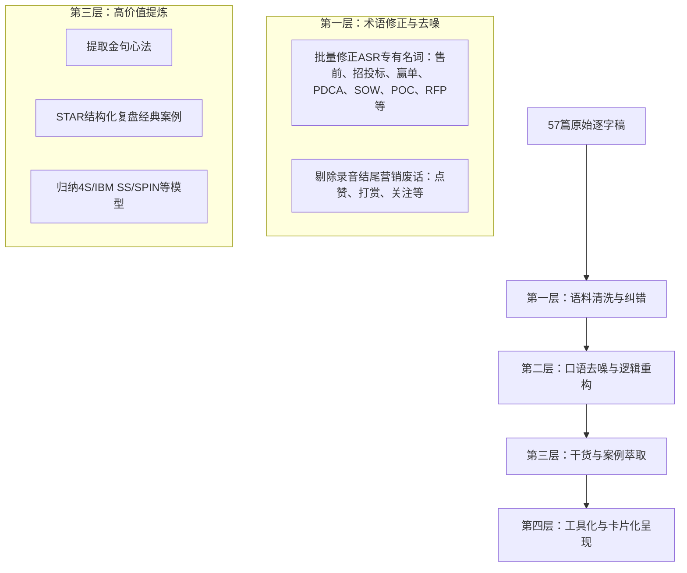
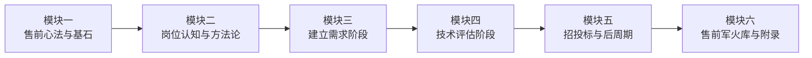

# 《售前工程师实战宝典学习笔记》产品需求文档（PRD）

---

| 文档版本 | 创建日期 | 状态 | 需求提出人 | 核心内容源 |
| :--- | :--- | :--- | :--- | :--- |
| **V1.0** | 2026-10-12 | 待确认评审 | 业务用户 | 赵成栋（CD老师）《4S专业售前法：从入门到精通》57篇课程逐字稿 |

---

## 1. 项目背景与产品定位

### 1.1 项目背景
该课程融合了全球主流销售与售前方法论（IBM Signature Selling/SS、SPIN提问法、FAB沟通法则、4S售前体系等）以及国内本土20余年复杂政企大客户打单实战经验。

然而，原始语料存在以下痛点：
1. **ASR（语音识别）噪点严重**：大量同音误识（如“授钱”->“售前”、“招图标”->“招投标”、“营单”->“赢单”、“PTC”->“PDCA”等）；
2. **口语化表达与信息密度分散**：口语停顿、重复、语气词多，每讲核心方法论与工具散落在口述叙事中；
3. **案例与干货未结构化**：丰富的实战案例（金融、电信、外企攻坚、单一来源翻盘等）缺乏清晰的复盘结构（背景-挑战-破局策略-售前动作-最终成效）。

### 1.2 产品定位
**不仅是一套文字精简的“摘要笔记”，而是一部面向一线B2B/政企高科技售前工程师、兼具理论深度与实操战斗力的《售前实战知识库与打法百科（Pre-Sales Playbook）》。**
* **体系性**：覆盖从售前职业认知、商机培育、需求引导、技术评估、招投标、合同签约到交付Handover的全生命周期。
* **工具化**：把课程中的隐性经验萃取为显性化的 SOP（标准作业程序）、Checklist（自查清单）、话术模板与决策矩阵。
* **战斗力**：保留真实商业环境中的“灰度空间”与博弈技巧，直击一线痛点（如防止被销售当枪使、防POC拖垮、反控标、写出律师级SOW等）。

---

## 2. 目标受众与用户画像（User Persona）

| 用户角色 | 核心痛点与诉求 | 本笔记满足的核心价值 |
| :--- | :--- | :--- |
| **转岗新手**<br>(研发/实施/技术支持转售前) | 角色认知不清，习惯用纯技术思维对话；不敢见客户，被销售随意指派写方案，缺乏业务大局观。 | 快速建立售前专业身份认同；掌握从“讲功能”到“讲业务价值”的思维转变；提供交流模板与基础SOP。 |
| **初中级售前**<br>(1~3年一线打单售前) | 技术交流抓不住痛点、PPT平铺直叙、演示频繁掉链子、客户要求试用/POC无力招架、标书写成拼盘。 | 掌握关键干系人识别与Champion培养技巧；学会两轮技术交流节奏控制、深度控标（影响RFP与评分表）方法。 |
| **资深售前/架构师**<br>(3~8年售前) | 陷入同质化价格战泥潭；难以在单一来源或劣势项目中翻盘；交付阶段扯皮多，SOW边界模糊。 | 掌握USP（独特卖点）设计心法；构建顾问式诊断与蓝图规划能力；编写“像律师一样严谨”的SOW。 |
| **售前团队管理者 / 销售总监** | 售前团队野蛮生长、各自为战，缺少统一打单方法论与赋能培训教材。 | 统一团队4S作业语言与协同规范，作为售前新人培养、技能等级评定与打单复盘的基准手册。 |

---

## 3. 语料输入处理与清洗策略

针对原始逐字稿，制定以下四层自动化与人工结合的清洗转化原则：



1. **专业术语标准化纠错表（词典映射）**：
   * `授钱` $\rightarrow$ `售前`
   * `招图标 / 招投标` $\rightarrow$ `招投标`
   * `营单` $\rightarrow$ `赢单`
   * `保典` $\rightarrow$ `宝典`
   * `PTC` $\rightarrow$ `PDCA循环`
   * `Unpremises` $\rightarrow$ `On-premises（私有化部署）`
   * `大东华区` $\rightarrow$ `大中华区`
   * `大名鼎鼎的IBM SS` $\rightarrow$ `IBM Signature Selling Method (SS销售方法论)`
2. **逻辑降噪与书面化**：
   * 消除冗余叹词（“那么”、“大家可以看到”、“这个这个”）；
   * 采用“论点 + 逻辑论证 + 实操佐证”的书面化层次表达。
3. **案例深度结构化还原**：
   * 将散落在讲师口述中的真实打单案例，统一定义为 **【背景情境】 $\rightarrow$ 【博弈难点】 $\rightarrow$ 【售前破局策略】 $\rightarrow$ 【关键动作】 $\rightarrow$ 【价值与启发】** 标准模型。

---

## 4. 知识架构与内容组织体系（模块大纲）

整个知识体系分为 **总论 + 五大实战模块 + 工具箱附录**，严格对应销售全流程闭环：



### 4.1 详细目录规划

* **第01章：导论与售前成功基石（对应原稿 1~5讲）**
  * 01.1 售前老兵的打单心法与认知进化
  * 01.2 4S专业售前法深度解析（Selling Orientation, Customer Success, Solution Engagement, Showcase Value）
  * 01.3 标杆战役复盘：从陪标绝境到单一来源采购
  * 01.4 标杆战役复盘：以硬核技术取胜助推客户成功上市
  * 01.5 标杆战役复盘：设计独特卖点（USP）逆风翻盘

* **第02章：售前岗位再认知与核心方法论（对应原稿 6~12讲）**
  * 02.1 售前的本质：摆脱方案“二把刀”与技术拼凑者标签
  * 02.2 售前三大业务价值：业务价值的“显示器”、“桥接器”与“放大器”
  * 02.3 售前职业全景发展路径：专家路线、管理路线与转型通道（售前能干到退休吗？）
  * 02.4 售前四大硬核底层能力模型
  * 02.5 售前服务对象：识别内部第一客户（销售伙伴）与外部客户
  * 02.6 国际知名企业销售方法论：深入拆解 IBM SS（Signature Selling）实战精髓
  * 02.7 复杂项目全销售阶段划分与售前分阶段核心职责蓝图

* **第03章：建立需求阶段——从商机发掘到蓝图规划（对应原稿 13~26讲）**
  * 03.1 客户评估：识别假商机，避免“竹篮打水一场空”
  * 03.2 售前启动前的“6看”尽调战术
  * 03.3 深度参与制定与更新客户销售计划（Account Plan）
  * 03.4 穿透客户行业与业务场景：从IT视角切换到业务视角
  * 03.5 售前核心命题：为何解决“Why Something（为何要做）”远先于“What/How”
  * 03.6 关键项目干系人（Key Stakeholders）识别、分类与权力矩阵
  * 03.7 发展客户内部同盟军：Champion（支持者）与 Sponsor（发起人）的培养与借力
  * 03.8 洞察干系人背后的驱动力：内在动机（个人利益）与外在逻辑（组织目标）转化
  * 03.9 设计不可替代的独特卖点（USP）：售前的攻防护城河
  * 03.10 SPIN提问技术在售前需求引导与痛点放大中的实战演练
  * 03.11 客户调研实操指南：“胆大、嘴甜、活又好”的亲密接触秘诀
  * 03.12 顾问式售前功力：问题诊断、解决方案蓝图与“既画大饼又做面条”的平衡术
  * 03.13 需求可行性评估与范围边界界定

* **第04章：技术评估阶段——攻防对抗与价值决胜（对应原稿 27~43讲）**
  * 04.1 动态调整售前计划：构建立体化、多层次售前攻势
  * 04.2 售前心态建设：对自家产品建立“红布信仰”
  * 04.3 售前沟通的标准语言体系：FAB法则（Feature-Advantage-Benefit）实战转换
  * 04.4 杀手级技术交流PPT的设计逻辑与内容编排
  * 04.5 售前演讲演说能力的高维进阶与临场控场技巧
  * 04.6 首轮技术交流策略：“展示肌肉能力，保留技术底裤”
  * 04.7 持续经营客户内部支持者：情报互换与同盟巩固
  * 04.8 友商与竞争对手态势实时跟踪与动态拆招
  * 04.9 第二轮技术交流策略：“亮剑锋芒，但不求一剑封喉”
  * 04.10 产品演示（Demo）的艺术：“捞干货、上硬菜”，拒绝流水账
  * 04.11 破解演示“墨菲定律”：Demo现场翻车排查与兜底容灾策略
  * 04.12 专业服务与实施交付能力的包装：“以人为核心”传递确定性
  * 04.13 概念验证（POC）测试控制指南：克制进场、设定边界、锁定标准
  * 04.14 向上汇报与CXO高层对话：“电梯演讲”争取一把手首肯
  * 04.15 警惕客户“试用陷阱”：识别白嫖风险与应对策略
  * 04.16 终极售前目标：深度影响与把控客户 RFP（招标文件）与评分标准设计

* **第05章：招投标与后商务周期——临门一脚与价值兑现（对应原稿 44~56讲）**
  * 05.1 政企客户常规招投标管理体系、法规与采购流程解密
  * 05.2 组建高效投标战队与制定严密投标倒计时计划
  * 05.3 技术点对点应答与偏离表编制：“完全满足”背后的风险与策略艺术
  * 05.4 投标文件技术方案撰写：警惕致命的“Copy-Paste”拼盘式失误
  * 05.5 SOW（项目工作说明书）撰写精要：像律师一样严密界定边界与权利
  * 05.6 售前维度的项目成本、工期与风险精密测算
  * 05.7 标书封标、检查与提交：“最后一公里”防踩坑 Checklist
  * 05.8 决胜开标与评标现场：述标技巧、答辩攻防与合规暗礁
  * 05.9 合同商务谈判配合：技术条款防守与给盟友写感谢信的职场智慧
  * 05.10 项目交付交接（Handover）：从售前到项目经理的无缝交棒
  * 05.11 维保与服务运营：在客户日常问题中挖掘二期、三期增购商机
  * 05.12 售前日常高频作战支持工具箱与实战应用场景

* **第06章：售前成长与进阶附录（对应原稿 57讲及延伸）**
  * 06.1 寄语售前同行：长期主义、职业尊严与认知护城河
  * 06.2 附录A：售前工程师实战必备全流程 Checklist 总表
  * 06.3 附录B：4S专业售前核心方法论速查卡片

---

## 5. 单篇笔记输出标准模版（Template Specification）

为了保证全书57讲内容质量统一、高密度、高可用，每讲按以下统一的【7步结构化模版】撰写：

```markdown
# 第X讲：[主题名称]

> **【本讲一句话心法】**：用一句高穿透力的话提炼本讲认知精髓。

### 一、 场景痛点与认知破局
- **一线实战痛点**：（为什么这件事情让很多售前吃大亏？销售怎么催？客户怎么刁难？）
- **常见认知误区**：（列举新手常见的错误认知与错误动作）
- **核心认知破局**：（从底层逻辑看，真正有效的思考维度是什么？）

### 二、 核心方法论与原理拆解
- 结合 IBM SS / 4S售前法 / SPIN / FAB 等方法论框架，拆解核心理论与分析逻辑。
- 采用流程图、对比表或公式清晰化呈现。

### 三、 售前实操标准动作（SOP / 打法步骤）
- **Step 1**：动作要点、关键输入与输出
- **Step 2**：...
- **Step 3**：...

### 四、 实战工具箱、话术与Checklist
- **实战话术示范**：客户说XX时，售前如何高情商、高专业度回答
- **核心模板/评估表**：（如：干系人评估矩阵、POC进场准入清单、SOW边界排他条款等）

### 五、 真实标杆案例深度复盘
- **案例背景**：客户类型、竞争态势、所处阶段
- **博弈难点**：遇到的死局或险境
- **售前动作**：如何运用本讲技巧破局
- **最终战果与实战启示**：给读者的经验借鉴

### 六、 血泪教训与避坑红线（Warning / Pitfalls）
- [!WARNING] 绝不可触碰的高压线
- [!TIP] 降低沟通成本与保护自身风险的实用技巧

### 七、 课后思考题与实战研讨指南
- **原课思考题1/2/3**
- **深度解析与破题思路**：给出可供一线实践参考的框架答案与行动指引
```

---

## 6. 交付物规格与文件结构设计

为方便阅读、检索与多端使用，建议项目在根目录下采用如下结构组织产物：

```
pre-sales-bible/
├── PRD_售前工程师实战学习笔记.md         # [本需求文档]
├── docs/                                  # 最终输出的规范化笔记目录
│   ├── 00_总览与学习指南.md                 # 售前知识图谱与全书导读
│   ├── 01_第一篇_售前心法与成功基石/        # 包含第01~05讲（5篇Markdown）
│   ├── 02_第二篇_售前岗位再认知与方法论/    # 包含第06~12讲（7篇Markdown）
│   ├── 03_第三篇_建立需求阶段实战指南/      # 包含第13~26讲（14篇Markdown）
│   ├── 04_第四篇_技术评估阶段实战指南/      # 包含第27~43讲（17篇Markdown）
│   ├── 05_第五篇_招投标与后周期实战指南/    # 包含第44~56讲（13篇Markdown）
│   └── 06_附录与售前实战军火库/            # 寄语、Checklist总表、工具清单
├── 文字稿/                                # 原始逐字稿（只读参考源）
```

---

## 7. 分阶段编写与交付计划（Roadmap）

由于全套课程共57篇长文，总字数达数十万字，为确保每一章节的质量与交付可控性，规划为四个阶段推进：

| 阶段 | 交付内容 | 包含讲数 | 核心目标 |
| :--- | :--- | :---: | :--- |
| **阶段 0** | **需求PRD确认与打样评审** | - | 确认PRD范围，完成1~2篇样板讲（如第2讲4S方法论、第16讲USP或第36讲控标）效果确认。 |
| **阶段 1** | **基石篇 + 认知篇** | 1~12讲 (12篇) | 奠定全书心法基础，打通4S体系与IBM SS销售方法论框架。 |
| **阶段 2** | **建立需求阶段** | 13~26讲 (14篇) | 攻坚客户评估、干系人关系、SPIN需求引导与咨询式蓝图设计。 |
| **阶段 3** | **技术评估阶段** | 27~43讲 (17篇) | 攻坚两轮技术交流、PPT/演讲、硬核Demo演示、POC控制与RFP深度控标。 |
| **阶段 4** | **招投标与后周期 + 附录整合** | 44~57讲 (14篇) | 完成标书制作、SOW严密撰写、防翻车Checklist及全套速查工具箱整合。 |

---

## 8. 待确认关键事项（Checkpoints for User Confirmation）

1. **产出粒度选择**：
   * **选项 A（标准精简版）**：按大章节归纳合并（每个大模块合并为1~2篇超长系统性文章，共6~8篇大文，适合快速通读）。
   * **选项 B（深度实战单篇版 - 推荐）**：严格按照原课48讲+导言逐讲深度拆解（每讲独立为一篇标准模块化笔记，保留全部实战案例、思考题与话术，形成完整的50+篇结构化知识库，适合随时翻查）。
2. **术语风格与表达口吻**：
   * 采用“专业、干练、面向一线打单”的顾问语气，是否需要特别融入特定行业（如通用SaaS、信创软硬件、智慧城市/政府大项目、云服务/系统集成）的特有背景，还是保持与课程一致的泛IT政企项目视角？
3. **首批样板讲验证**：
   * 是否同意先由我为您制作 **1篇样板讲（例如：第2讲《4S专业售前法介绍》或第36讲《终极售前目标：深度影响RFP内容和评分标准设计》）** 供您查阅结构排版效果，确认满意后启动分批次完整撰写？
