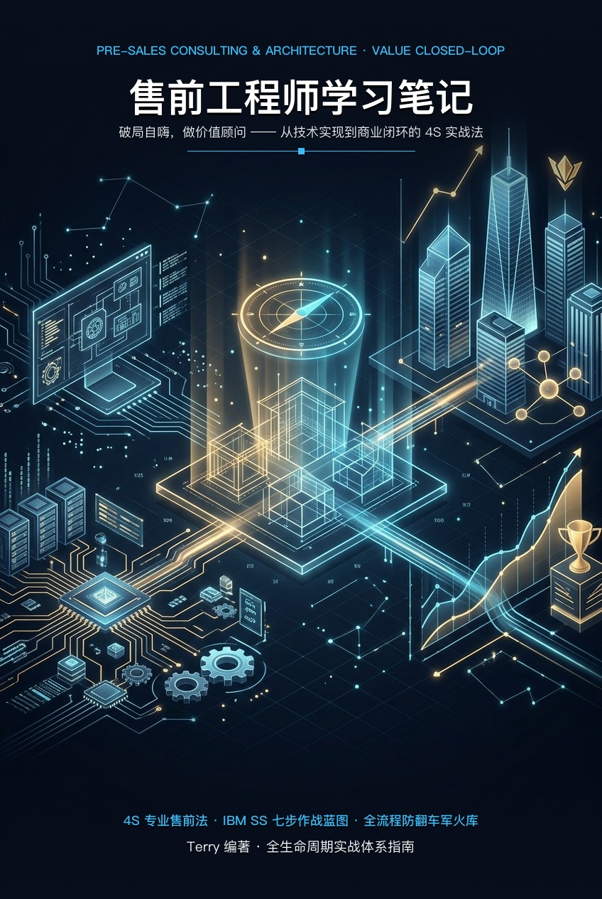
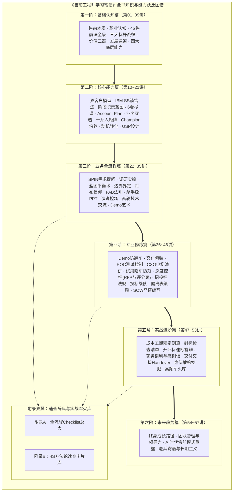
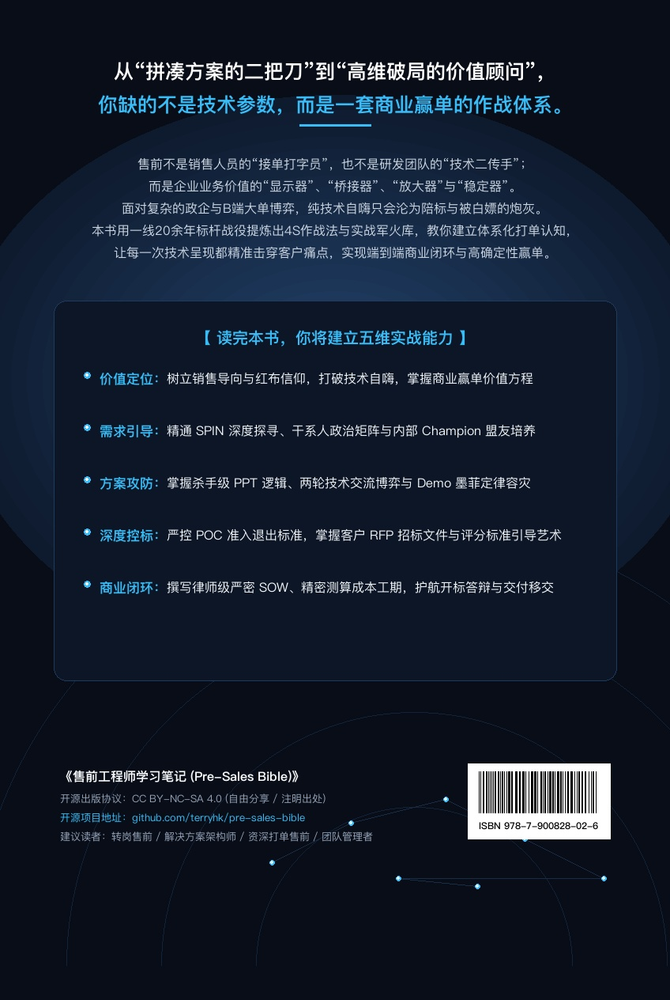

# 售前工程师学习笔记 (Pre-Sales Bible)

> **从技术实现到商业闭环——用 4S 咨询思维与全流程作战体系打造顶级解决方案专家**

---

## 封面

  
   
  <em>《售前工程师学习笔记》封面</em>

## 关于本书

很多做技术出身的工程师（开发、运维、实施）转型做售前，或者初入售前行业的同学，常常陷入三个经典困局：
1. **“方案二把刀与技术搬运工”**：只懂罗列自家产品参数，给客户讲了一堆先进技术，客户却反问“这和我的业务有什么关系？”
2. **“被销售当枪使，天天疲于奔命”**：只要销售一个电话就去现场讲 PPT、搭环境，结果打了一堆假商机和陪标项目，成了“免费劳动力”；
3. **“POC 被白嫖，招投标前功尽弃”**：测试做到筋疲力尽，最后客户却拿你的测试报告给友商压价，或者在控标和评分标准上被竞争对手一剑封喉。

本书基于前 **IBM / HP / 思科 / BMC 资深售前总监**、《精通售前》译者**赵成栋（CD老师）** 20 余年外企与大厂一线打单战役录音逐字稿深度萃取重构而成。

全书彻底破除“售前就是讲 PPT 的”肤浅认知，贯穿一条由第一性原理驱动的核心价值方程式：

$$\text{商业洞察 (Insight)} \times \text{方案设计 (Solution)} \times \text{同盟信任 (Trust)} = \text{商业赢单 (Win-Win Closed)}$$

售前不是单纯的技术人员，而是**业务价值的显示器、桥接器与放大器**。你所交付的不仅是一份技术方案，更是一份**客户投资成功、企业实现盈利的商业契约**。

---

## 适合谁读

- **研发 / 实施 / 运维转型售前**：打破单纯的技术实现视角，快速建立“以商业价值为导向”的职业思维底座；
- **1~3 年一线打单售前**：掌握客户需求引导（SPIN）、干系人政治矩阵、杀手级 PPT、高情商 Demo 与深度控标的核心动作；
- **资深售前 / 解决方案架构师**：精进“既画大饼又做面条”的蓝图平衡术，设计不可替代的 USP，编写“像律师一样严密”的 SOW；
- **售前团队负责人与销售协同者**：建立统一团队 4S 打单作战语言，沉淀售前全流程管理门禁（Gating）与新人训战规范。

---

## 学习路线

本书提供多轨针对性学习路线：

- 🚀 **新锐转型实训路线**：[00 总览](00_总览与知识地图.md) $\to$ [第01-09讲（心法与底层能力）](01_第一篇_售前心法与成功基石/01_课程导读与售前专业进化路径.md) $\to$ [第10-12讲（服务对象与阶段蓝图）](02_第二篇_售前岗位再认知与方法论/10_售前服务对象_谁才是售前最重要的客户.md) $\to$ [第27-32讲（交流技巧与演讲）](04_第四篇_技术评估阶段实战指南/27_技术评估阶段概述与攻势构建.md)；
- 🎯 **大项目打单决胜路线**：[第13-15讲（假商机识别与6看尽调）](03_第三篇_建立需求阶段实战指南/13_建立需求阶段概述与前置准备.md) $\to$ [第19-21讲（干系人矩阵与Champion同盟）](03_第三篇_建立需求阶段实战指南/19_识别分类与管理关键项目干系人Key_Stakeholders.md) $\to$ [第22讲（USP独特卖点）](03_第三篇_建立需求阶段实战指南/22_设计不可替代的独特卖点USP_售前的攻防护城河.md) $\to$ [第40-43讲（POC控制与深度控标）](04_第四篇_技术评估阶段实战指南/40_概念验证POC测试控制_克制进场设定边界锁定标准.md) $\to$ [第47-52讲（招投标与开标答辩）](05_第五篇_招投标与后周期实战指南/47_点对点应答与偏离表编制_完全满足背后的风险与艺术.md)；
- 🛡️ **交付避坑与商务风控路线**：[第26讲（可行性评估红线）](03_第三篇_建立需求阶段实战指南/26_项目需求梳理与可行性评估红线.md) $\to$ [第38讲（Demo容灾）](04_第四篇_技术评估阶段实战指南/38_破解演示墨菲定律_Demo现场翻车排查与兜底容灾.md) $\to$ [第49讲（SOW严密撰写）](05_第五篇_招投标与后周期实战指南/49_SOW工作说明书撰写精要_像律师一样严密界定边界.md) $\to$ [第54讲（交付交接Handover）](05_第五篇_招投标与后周期实战指南/54_项目交付交接Handover_从售前到项目经理的无缝交棒.md)；
- 📖 **体系通读精进路线**：自底向上通读第 01~57 讲全量内容，结合 [附录A 术语表](06_附录与售前实战军火库/附录A_售前工程师实战必备全流程Checklist总表.md) 与 [附录B 军火库](06_附录与售前实战军火库/附录B_4S专业售前核心方法论速查卡片.md) 实操演练。

---

## 全书架构全景（六阶火箭模型）

---

## 篇章导读与章节速查

### [全书总览与知识地图](00_总览与知识地图.md)
* 4S 专业售前法全景架构、知识拓扑关系图、核心方法论速查索引。

### [第一部分：售前心法与成功基石（第01~05讲）](01_第一篇_售前心法与成功基石/01_课程导读与售前专业进化路径.md)
* **[第01讲：课程导读与售前专业进化路径](01_第一篇_售前心法与成功基石/01_课程导读与售前专业进化路径.md)**：破除技术思维局限，开启商业顾问式售前进化之旅；
* **[第02讲：4S专业售前法体系深度解析](01_第一篇_售前心法与成功基石/02_4S专业售前法体系深度解析.md)**：Selling Orientation, Customer Success, Solution Engagement, Showcase Value；
* **[第03讲：标杆战役复盘：从陪标绝境到单一来源采购](01_第一篇_售前心法与成功基石/03_标杆战役复盘_从陪标绝境到单一来源.md)**：经典绝地反击战，如何把陪标逆转为唯一中标商；
* **[第04讲：标杆战役复盘：硬核技术取胜助推客户成功上市](01_第一篇_售前心法与成功基石/04_标杆战役复盘_靠技术取胜助推客户上市.md)**：用技术确定性对冲业务风险，深度绑定客户核心成功指标；
* **[第05讲：标杆战役复盘：巧设独特卖点（USP）逆风翻盘](01_第一篇_售前心法与成功基石/05_标杆战役复盘_巧设USP逆风翻盘.md)**：在友商占优的死局中构建非对称竞争壁垒。

### [第二部分：售前岗位再认知与方法论（第06~12讲）](02_第二篇_售前岗位再认知与方法论/06_什么是售前_摆脱方案二把刀与拼凑者定位.md)
* **[第06讲：什么是售前：摆脱方案“二把刀”与拼凑者定位](02_第二篇_售前岗位再认知与方法论/06_什么是售前_摆脱方案二把刀与拼凑者定位.md)**：打破二传手定位，成为懂业务、懂架构的解决方案专家；
* **[第07讲：售前的价值：业务价值的显示器、桥接器、放大器与稳定器](02_第二篇_售前岗位再认知与方法论/07_售前的价值_业务价值的显示器桥接器放大器稳定器.md)**：售前对销售、客户与交付团队的四大系统级杠杆；
* **[第08讲：售前的职业发展路径：售前可以做到退休吗？](02_第二篇_售前岗位再认知与方法论/08_售前职业发展路径_售前可以干到退休吗.md)**：专家线、管理线、销售线与创业线的全景通道；
* **[第09讲：售前核心能力模型：以求胜为箭矢的T型能力结构](02_第二篇_售前岗位再认知与方法论/09_售前核心能力模型_以求胜为箭矢的T型能力结构.md)**：商业洞察、方案架构、演讲演说与商务推动的闭环；
* **[第10讲：售前服务对象：谁才是售前最重要的客户？](02_第二篇_售前岗位再认知与方法论/10_售前服务对象_谁才是售前最重要的客户.md)**：解密“销售是售前的第一客户”背后的组织协同秘密；
* **[第11讲：国际大厂销售方法论：深入拆解IBM SS七步法实战精髓](02_第二篇_售前岗位再认知与方法论/11_国际大厂销售方法论_深入拆解IBM_SS七步法实战精髓.md)**：Signature Selling Method 在复杂 B 端大项目中的降维打击；
* **[第12讲：销售过程阶段划分与售前分阶段职责全景蓝图](02_第二篇_售前岗位再认知与方法论/12_销售过程阶段划分与售前分阶段职责全景蓝图.md)**：商机萌芽、需求建立、方案评估、招投标与交付交接的门禁职责。

### [第三部分：建立需求阶段实战指南（第13~26讲）](03_第三篇_建立需求阶段实战指南/13_建立需求阶段概述与前置准备.md)
* **[第13~15讲：客户评估、假商机识别与“6看”尽调战术](03_第三篇_建立需求阶段实战指南/15_售前启动工作前的6看尽调战术.md)**：看背景、看财报、看现状、看痛点、看预算、看关系；
* **[第16~18讲：Account Plan与穿透业务——Why Something远先于What/How](03_第三篇_建立需求阶段实战指南/18_售前核心命题_为何解决Why_Something远先于What和How.md)**：不谈业务的售前没有未来；
* **[第19~21讲：干系人权力矩阵、同盟军 Champion 培养与动机转化](03_第三篇_建立需求阶段实战指南/19_识别分类与管理关键项目干系人Key_Stakeholders.md)**：解构企业政治与个人诉求；
* **[第22讲：设计不可替代的独特卖点（USP）：售前的攻防护城河](03_第三篇_建立需求阶段实战指南/22_设计不可替代的独特卖点USP_售前的攻防护城河.md)**：USP 九宫格与差异化锁定；
* **[第23~26讲：SPIN需求提问、调研实操、“画饼与做面”及范围红线](03_第三篇_建立需求阶段实战指南/23_SPIN提问技术在售前需求开发中的实战落地.md)**：顾问式售前的现场控场与需求把控。

### [第四部分：技术评估阶段实战指南（第27~43讲）](04_第四篇_技术评估阶段实战指南/27_技术评估阶段概述与攻势构建.md)
* **[第27~30讲：红布信仰、FAB法则、杀手级PPT编排与高维演讲控场](04_第四篇_技术评估阶段实战指南/30_售前语言习惯_FAB利益陈述法则.md)**：把产品特性转化为客户能感知到的直接利益；
* **[第31~36讲：两轮技术交流攻防、竞对拆招与内部支持者情报互换](04_第四篇_技术评估阶段实战指南/33_首轮技术交流_展示能力肌肉保留技术底裤.md)**：首轮留底牌，二轮亮锋芒；
* **[第37~38讲：产品演示（Demo）艺术与墨菲定律翻车排查兜底](04_第四篇_技术评估阶段实战指南/38_破解演示墨菲定律_Demo现场翻车排查与兜底容灾.md)**：捞干货、上硬菜、离线容灾；
* **[第39~42讲：交付包装、POC克制进场、CXO电梯汇报与防白嫖策略](04_第四篇_技术评估阶段实战指南/40_概念验证POC测试控制_克制进场设定边界锁定标准.md)**：控制验证边界，结果直接锁定商务协议；
* **[第43讲：终极售前目标：深度影响与把控客户 RFP 内容与评分标准设计](04_第四篇_技术评估阶段实战指南/43_终极售前目标_深度影响与把控客户RFP内容与评分标准设计.md)**：售前最高境界——控标。

### [第五部分：招投标与后周期实战指南（第44~56讲）](05_第五篇_招投标与后周期实战指南/44_招投标与商务采购阶段概述.md)
* **[第44~46讲：招投标法规、采购流程解密、投标战队组建与倒排计划](05_第五篇_招投标与后周期实战指南/45_政企客户常规招投标管理体系与采购流程解密.md)**：合规第一，分工协作；
* **[第47~49讲：点对点偏离表策略、方案撰写与“像律师一样严密”的 SOW](05_第五篇_招投标与后周期实战指南/49_SOW工作说明书撰写精要_像律师一样严密界定边界.md)**：防翻车、防扯皮、防烂尾；
* **[第50~52讲：成本工期精密测算、封标防废标清单与评标答辩攻防](05_第五篇_招投标与后周期实战指南/51_标书封标检查与提交_最后一公里防翻车Checklist.md)**：行百里者半九十；
* **[第53~56讲：商务谈判配合、交付交接 Handover、维保增购与日常军火库](05_第五篇_招投标与后周期实战指南/54_项目交付交接Handover_从售前到项目经理的无缝交棒.md)**：全生命周期闭环。

### [第六部分：职业进化与实战军火库（第57讲 + 附录）](06_附录与售前实战军火库/57_寄语售前同行_长期主义职业尊严与认知护城河.md)
* **[第57讲：寄语售前同行：长期主义、职业尊严与认知护城河](06_附录与售前实战军火库/57_寄语售前同行_长期主义职业尊严与认知护城河.md)**：守住职业底线，敬畏商业常识；
* **[附录A：售前工程师实战必备全流程 Checklist 总表](06_附录与售前实战军火库/附录A_售前工程师实战必备全流程Checklist总表.md)**：从商机初访到项目交接的自查清单；
* **[附录B：4S专业售前核心方法论速查卡片库](06_附录与售前实战军火库/附录B_4S专业售前核心方法论速查卡片.md)**：核心模型、评估矩阵与高情商话术速查。

---

## 背面

  
   
  <em>《售前工程师学习笔记》背面</em>

## 许可证

本书内容采用 [CC BY-NC-SA 4.0](https://creativecommons.org/licenses/by-nc-sa/4.0/) 知识共享许可协议发布。
允许个人学习、引用与传播，禁止未经授权的商业化运作。
